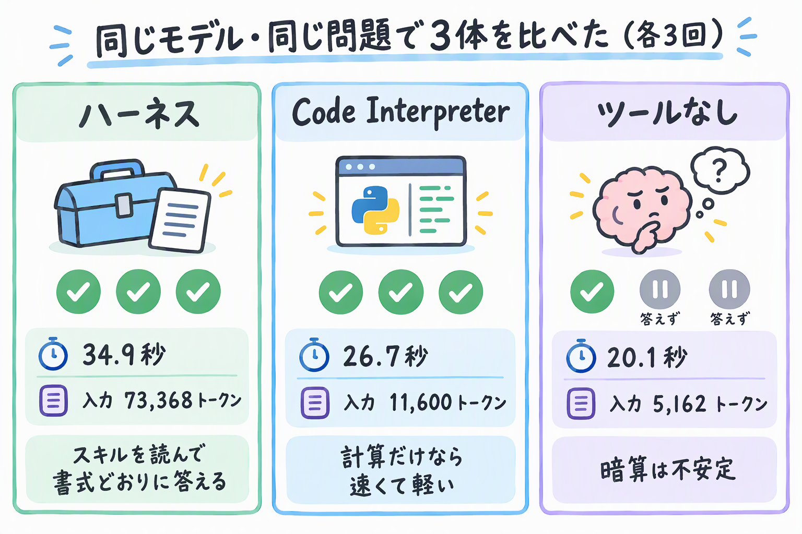
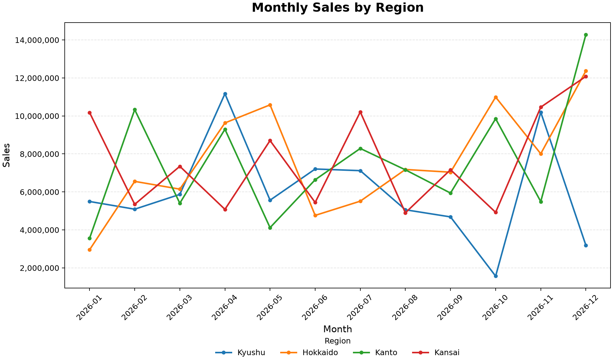

Microsoft FoundryのプロンプトエージェントでMicrosoft Copilot Harness（プレビュー）が使えるようになったので、さっそく動かしてみました。

ハーネスってそもそも何？という話は、こちらにまとめています。

https://zenn.dev/nomhiro/articles/microsoft-copilot-harness-foundry

この記事は、実際に動かしたときのメモです。

:::message alert
2026年10月31日時点の内容です。プレビューなので、仕様は変わる可能性があります。
:::

# 環境

| 項目 | 内容 |
|------|------|
| リージョン | Japan East（新規にプロジェクトを作成） |
| モデル | `gpt-6-luna`（2026-09-22、GlobalStandard） |
| azd | 1.37.2 |
| Foundry拡張 | `azure.ai.agents` 1.0.0-beta.23 |
| Python SDK | `azure-ai-projects` 2.10.0 |
| GitHub Copilot CLI | 1.0.102 |

azdは1.37.0以上が必要です。手元が1.28だったので更新しました。

```powershell
winget upgrade Microsoft.Azd
azd extension install microsoft.foundry
azd extension update microsoft.foundry
```

ハーネスを使うときは、この環境変数も必要です。シェルを開くたびに設定します。

```bash
export AZD_ALPHA_ENABLE_AGENTS_MANAGED_HARNESS=true
```

# ハーネス付きのエージェントを作る

`azd ai agent init`に`--harness`オプションがありました。

```bash
azd ai agent init harness-analyst \
  --no-prompt \
  --kind prompt \
  --agent-name harness-analyst \
  --model gpt-6-luna \
  --harness microsoft_copilot_preview \
  --instructions "You are a careful data analyst."
```

対応リージョンも教えてくれます。Japan Eastが入っていて一安心。

```text
The Microsoft Copilot harness requires a Foundry project in one of these regions: australiaeast, canadacentral, centralus, germanywestcentral, japaneast, swedencentral, uksouth, westeurope, westus.
```

## スキルを書く

売上データを集計して、決まった書式でレポートにするスキルを用意しました。

```markdown:skills/sales-report-ja/SKILL.md
---
name: sales-report-ja
description: 売上データ（CSV）を集計して、日本語の売上レポートを決まった書式で作る。売上の集計、地域別・商品別の比較、月次の推移を聞かれたときに使う。
---

# 売上レポート（日本語）

## 集計のルール

1. 数値は頭の中で計算しない。必ずコード（Python など）で CSV を読み込んで計算する。
2. 売上金額は `units * unit_price * (1 - discount_rate)` で行ごとに求めてから合計する。
3. 合計値は、地域別の合計を足した値と、全行を直接足した値の2通りで検算し、一致を確認する。
4. 金額は円単位に四捨五入し、3桁区切り（例: 12,345,678円）で書く。

## レポートの書式

- `## 結論`: 質問への答えを2〜3行で
- `## 集計結果`: Markdown の表で
- `## 検算`: 2通りの合計値と、一致したかどうか
- `## 前提と注意`: 計算式、欠損値の扱いなど
```

## azure.yaml

生成された`azure.yaml`に、モデルのデプロイとスキルを足しました。

```yaml:azure.yaml
services:
    ai-project:
        host: azure.ai.project
        deployments:
            - name: gpt-6-luna
              model:
                  format: OpenAI
                  name: gpt-6-luna
                  version: '2026-09-22'
              sku:
                  name: GlobalStandard
                  capacity: 200

    sales-report-ja:
        host: azure.ai.skill
        uses:
            - ai-project
        archive: ./skills/sales-report-ja

    harness-analyst:
        host: azure.ai.agent
        kind: prompt
        model: gpt-6-luna
        harness:
            type: microsoft_copilot_preview
        instructions: |
            あなたは慎重なデータアナリストです。売上データの質問には、添付のスキル sales-report-ja に従って答えてください。
            数値を推測で書かず、根拠を示してください。
        skills:
            - sales-report-ja
        uses:
            - ai-project
            - sales-report-ja
```

ハーネスを付けるのは`harness.type: microsoft_copilot_preview`の1項目だけです。

## デプロイ

```bash
azd env set AZURE_LOCATION japaneast
azd env set AZURE_RESOURCE_GROUP rg-copilot-harness-poc
azd env set AZURE_AI_PROJECT_NAME copilot-harness-poc
azd up --no-prompt
```

リソースグループからエージェントまで、1回で全部できました。`azd ai agent show --output json`で見ると、ちゃんとハーネスとスキルが付いています。

```json
"definition": {
  "harness": { "type": "microsoft_copilot_preview" },
  "kind": "prompt",
  "model": "gpt-6-luna",
  "skills": [ { "name": "sales-report-ja", "version": "1" } ]
}
```

## ハマったところ: usesに書くとスキルが付いてしまう

比較用のエージェント（ハーネスなし）も同じ`azure.yaml`に書いたら、azdに「`uses`に`sales-report-ja`を書け」と怒られました。

言われたとおりに足したところ、`skills`に書いていないエージェントにもスキルが付いていました。ドキュメントには「`uses`だけでは付かない」とあるので、beta.23時点ではドキュメントと動きが違うようです。

しかたないので、比較用の2体はPython SDKで作り直しました。

```python:scripts/create_baselines.py
import os

from azure.ai.projects import AIProjectClient
from azure.ai.projects.models import CodeInterpreterTool, PromptAgentDefinition
from azure.identity import DefaultAzureCredential

ENDPOINT = os.environ["FOUNDRY_PROJECT_ENDPOINT"]  # azd env get-value FOUNDRY_PROJECT_ENDPOINT
INSTRUCTIONS = "あなたは慎重なデータアナリストです。\n数値を推測で書かず、根拠を示してください。\n"

project = AIProjectClient(endpoint=ENDPOINT, credential=DefaultAzureCredential(), allow_preview=True)

# ハーネスなし、ツールなし
project.agents.create_version(
    agent_name="default-analyst",
    definition=PromptAgentDefinition(model="gpt-6-luna", instructions=INSTRUCTIONS),
)
# ハーネスなし + Code Interpreter
project.agents.create_version(
    agent_name="default-ci-analyst",
    definition=PromptAgentDefinition(
        model="gpt-6-luna", instructions=INSTRUCTIONS, tools=[CodeInterpreterTool()]
    ),
)
```

ちなみにSDKには`MicrosoftCopilotHarness`と並んで`GitHubCopilotHarness`というクラスも残っていました。改名の名残ですね。

# やってみた

## 使えるツールを聞いてみる

3体に「使えるツールを全部教えて」と聞きました。ハーネス付きは、先に会話（conversation）を作ってから呼びます。

```python
openai = project.get_openai_client(agent_name="harness-analyst")
conv = openai.conversations.create()
res = openai.responses.create(
    conversation=conv.id,
    input="あなたが使えるツールを全部、名前だけ箇条書きで教えてください。",
)
```

| エージェント | ツール | 入力トークン |
|------|------|------|
| ハーネス付き | 15個 | 11,907 |
| Code Interpreter付き | 2個 | 713 |
| ツールなし | なし | 61 |

ハーネス付きが答えたのはこの15個。

```text
bash, view, web_fetch, skill, task, read_agent, list_agents, write_agent,
task_complete, download_file_from_foundry_project_to_workspace,
upload_file_from_workspace_to_foundry_project, apply_patch, rg, glob,
multi_tool_use.parallel
```

`apply_patch`、`rg`、`glob`。GitHub Copilotでおなじみの顔ぶれです。

ただ、一言聞いただけで入力が11,907トークン。ツールの定義などを毎回渡しているみたいです。

## 同じ問題を3体に解かせる

240行の売上CSVをプロンプトに貼って、合計、地域別の最大、前月比の最大、伸び率の最大の4つを聞きました。関西と北海道の差が約11万円しかない、暗算だと間違えやすいデータです。

各3回、新しい会話で実行しました。

| エージェント | 全問正解 | 答えなかった | 所要時間の中央値 | 入力トークンの中央値 |
|------|------|------|------|------|
| ハーネス付き | 3回 | 0回 | 34.9秒 | 73,368 |
| Code Interpreter付き | 3回 | 0回 | 26.7秒 | 11,600 |
| ツールなし | 1回 | 2回 | 20.1秒 | 5,162 |



計算するだけなら、Code Interpreterで十分でした。速いし、トークンも約6分の1。

ツールなしは、1回目は推論だけで94秒かけて全問正解。2回目と3回目は「集計できないので推測しません」と言って、コードだけ返してきました。正直者です。

ハーネス付きは、3回とも同じ流れでした。

```text
function_call  skill {"skill": "sales-report-ja"}     ← まずスキルを読む
shell_call     python - <<'PY' ...                    ← シェルでPythonを動かす
message        ## 結論 ...                             ← スキルの書式で答える
```

答えもスキルどおり、「結論、集計結果、検算、前提と注意」の4つの見出しで返ってきました。

```markdown
## 検算
全行を直接合計した売上は346,172,503円、地域別売上合計の合計も346,172,503円で、一致しました（240行）。
```

指示には「スキルに従って」としか書いていないので、ちゃんとスキルを読みに行っています。

3回目は、スキルを読んだあとに`glob`で`**/AGENTS.md`を探していました。GitHub Copilotそのものの動きでちょっと笑いました。

## ファイルを渡してグラフを作ってもらう

今度はCSVをFoundry Filesにアップロードして、ファイルとして渡しました。お題は「地域別の月次売上の折れ線グラフをPNGで」。

先に、エージェントのIDにFoundry Userロールを付けておきます。作ったファイルを、エージェントがFoundry Filesにアップロードするためです。

```bash
# Git Bashではパスが書き換えられるので MSYS_NO_PATHCONV=1 を付ける
MSYS_NO_PATHCONV=1 az role assignment create \
  --assignee-object-id "<instance_identity.principal_id>" \
  --assignee-principal-type ServicePrincipal \
  --role "53ca6127-db72-4b80-b1b0-d745d6d5456d" \
  --scope "<Foundry プロジェクトのリソース ID>"
```

ファイルは`input_file`で添付します。

```python
files_client = project.get_openai_client()
agent_client = project.get_openai_client(agent_name="harness-analyst")

with open("data/sales_2026.csv", "rb") as f:
    uploaded = files_client.files.create(file=("sales_2026.csv", f, "text/csv"), purpose="assistants")
conv = agent_client.conversations.create()
res = agent_client.responses.create(
    conversation=conv.id,
    input=[{
        "role": "user",
        "content": [
            {"type": "input_text", "text": PROMPT},
            {"type": "input_file", "file_id": uploaded.id},
        ],
    }],
)
```

44.5秒で返ってきました。

```text
File: monthly_sales_by_region.png
Download ID: assistant-Hn6EJLmdTUBW1fjLsXLJSD
```



途中の動きを追うと、なかなか健気でした。

1. スキルを読む
2. 添付したCSVが`/home/session/workspace/data/`に置かれているのを見つける
3. `matplotlib`がなくて失敗
4. 自分で`pip install matplotlib`
5. 日本語フォントがなくて地域名が描けない
6. 地域名を英語にして描き直す
7. スキルどおり2通りで検算（`verified=True`）
8. Foundry FilesにPNGをアップロード

2回つまずいて、2回とも自分で立て直しています。グラフを頼んだだけなのに、検算もしていました。

入力トークンは161,501（うち139,699がキャッシュ）。ループを回す分、量は増えますが、キャッシュがよく効いていました。

## 同じSKILL.mdをGitHub Copilot CLIで動かす

最後に、Foundry用に書いた`SKILL.md`を、そのまま手元のCopilot CLIに置いてみました。

```bash
mkdir -p copilot-cli-local/.github/skills/sales-report-ja copilot-cli-local/data
cp harness-analyst/skills/sales-report-ja/SKILL.md copilot-cli-local/.github/skills/sales-report-ja/
cp harness-analyst/data/sales_2026.csv copilot-cli-local/data/
cd copilot-cli-local
copilot skill list
```

```text
  sales-report-ja - 売上データ（CSV）を集計して、日本語の売上レポートを決まった書式で作る。...
```

認識されました。そのまま頼んでみます。

```bash
copilot -p "data/sales_2026.csv の売上レポートを作ってください。全体合計、地域別合計と最も売上が大きい地域を知りたいです。" \
  --allow-all-tools --trust-folder
```

```text
● skill(sales-report-ja)

● 集計して売上レポートの数値を検算 (shell)

## 結論
全体の売上合計は **346,172,503円** です。
地域別では **関西が91,848,466円で最も大きい** 売上となっています。
...
## 検算
- 全行を直接合計: **346,172,503円**
- 地域別合計を合算: **346,172,503円**
- 検算結果: **一致**
```

Foundryと同じ見出しで、同じ数字が出ました（98秒）。同じスキルファイルが、手元でもクラウドでもそのまま動きます。

:::message
`--allow-all-tools`を付けると、Copilot CLIは確認なしに手元のPCでシェルを実行します。試すなら使い捨てのフォルダで。モデルもCopilot側が選んだものなので、Foundryとの速さの比較にはなっていません。
:::

# 片付け

```bash
cd harness-analyst
azd down --purge --force --no-prompt
```

:::message alert
`--purge`を付けると元に戻せません。共有しているプロジェクトでは実行しないでください。
:::

# 所感

`harness`の1項目を足すだけで、スキルを読み、失敗から立て直し、検算してファイルで返すところまでやってくれました。GitHub Copilotの動きがそのままFoundryに来た感じです。

計算だけならCode Interpreterのほうが速くて軽いので、何ステップもある作業を任せたいときに使うのがよさそうです。12月1日まではランタイム無料なので、今のうちにいろいろ試しておきたいところ。
