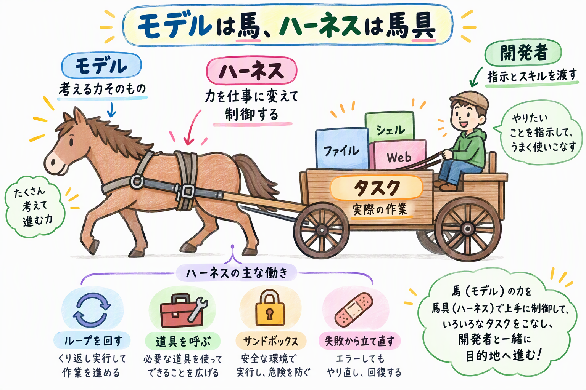
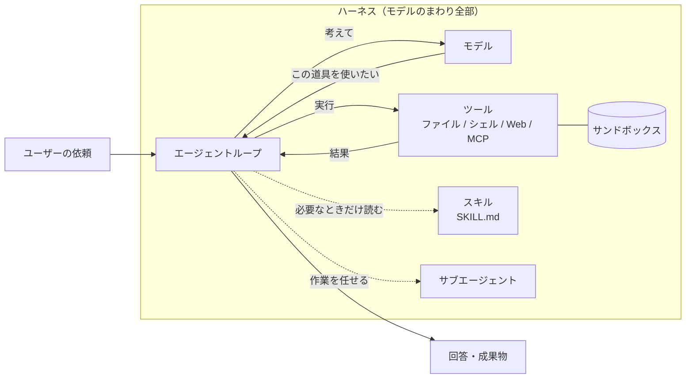
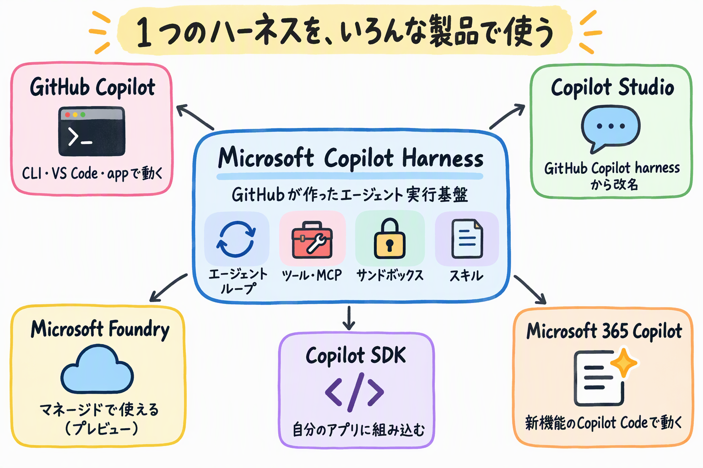
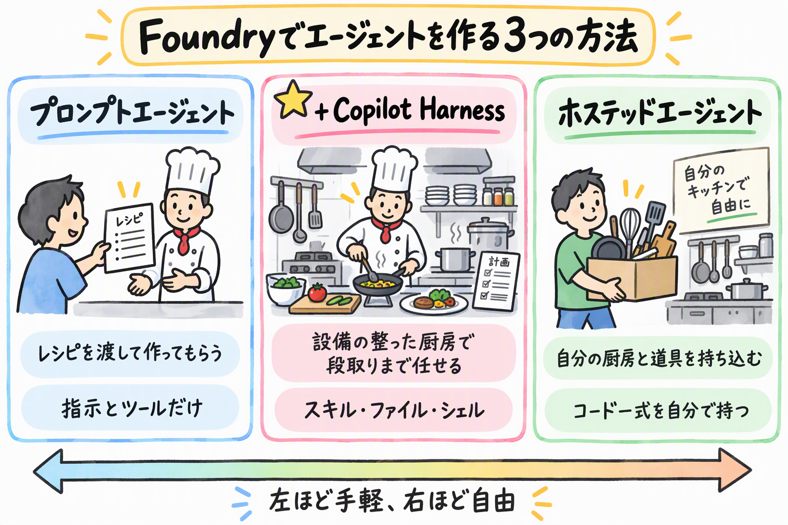
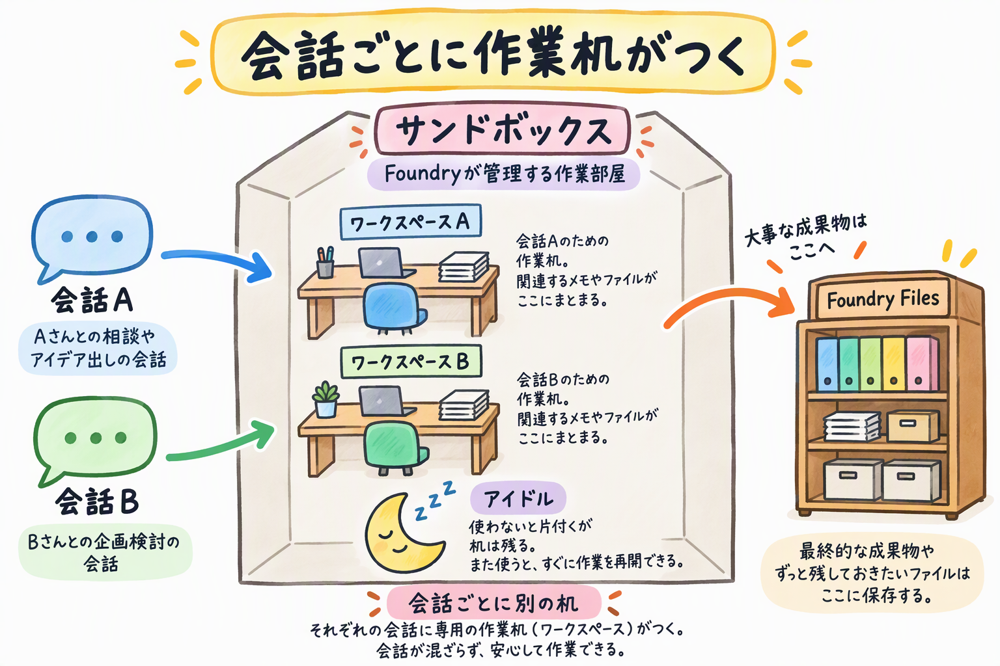
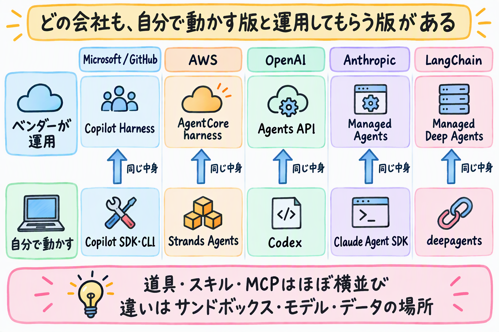

# はじめに

2026年10月28日に、Microsoftが「**Microsoft Copilot Harness**」を発表しました。GitHubのチームが作り、GitHub CopilotやCopilot Studioの裏側で動いているエージェントの実行基盤です。これがMicrosoft Foundryでも使えるようになりました（パブリックプレビュー）。

https://devblogs.microsoft.com/foundry/microsoft-copilot-harness-in-foundry/

この記事は、実際にいろいろ試す前に、情報を整理しておきたくてまとめたものです。

実際に動かしてみた結果は、別の記事にまとめています。

https://zenn.dev/nomhiro/articles/microsoft-copilot-harness-foundry-try

> Microsoft Copilot Harnessは、モデルのまわりにある「考える→道具を使う→結果を見る→また考える」の繰り返しを丸ごと引き受けてくれる、GitHubが作ったエージェントの実行基盤です。

このブログで書くのは、次の4つです。

- ハーネスとは何か、Microsoftのどの製品で使われているか
- Foundryで何が変わるのか（3通りの作り方、ハーネスのツール、ワークスペース）
- AWS、OpenAI、Anthropic、LangChain、Googleのハーネスと比べて、何が違うのか
- Foundry、GitHub Copilot、Copilot Studio・Microsoft 365の立場ごとに、何が嬉しいのか

:::message alert
本記事の内容は **2026年10月31日時点** の情報に基づいています。FoundryのCopilot Harnessはパブリックプレビューのため、仕様や料金は変わる可能性があります。
:::

## 参考情報

https://blogs.microsoft.com/blog/2026/10/28/introducing-the-microsoft-copilot-harness-unlocking-the-potential-of-truly-multi-model-agentic-work/
https://learn.microsoft.com/azure/foundry/agents/how-to/use-tools-skills-copilot-harness
https://github.com/microsoft-foundry/foundry-samples/tree/main/samples/cli/prompt-agents/microsoft-copilot-harness

---

# そもそも「ハーネス」って？

ハーネス（harness）は、もともと馬具のことです。馬がどれだけ力持ちでも、馬具がなければ荷車は引けませんし、御者が向きを変えることもできません。馬の力を仕事に変えて、しかも人が制御できるようにする道具が馬具です。

AIエージェントでいうと、**馬がモデル**、**馬具がハーネス**です。Microsoftの発表でも「the harness is everything around the model（ハーネスはモデルのまわりにあるもの全部）」と説明しています。



モデル単体ができるのは「テキストを受け取って、テキストを返す」ことだけです。エージェントとして仕事をさせるには、まわりに次のような仕組みがいります。

| ハーネスが受け持つこと | 具体的には |
|------|------|
| エージェントループ | モデルに考えさせる → ツールを呼ぶ → 結果をモデルに返す、をタスクが終わるまで繰り返す |
| ツール | ファイルの読み書き、シェル、Web取得、MCPサーバーなどを呼べるようにする |
| 実行環境 | コードやコマンドを安全に動かせる隔離された場所（サンドボックス）を用意する |
| コンテキスト管理 | 長い作業でも、モデルに渡す情報があふれないように整理する |
| スキル・サブエージェント | 手順書を必要なときだけ読み込む、作業の一部を別のエージェントに任せる |
| 失敗からの立て直し | ツールが失敗したら、やり方を変えてもう一度試す |

図にすると、こんな感じです。



自分でエージェントを作ったことがある方は、このループをLangChainやSemantic Kernel、Agent Frameworkで組んだ経験があると思います。動くものはすぐできるんですよね。ただ、ツールが失敗したときのリトライ、長い会話のコンテキスト整理、コードを安全に動かす場所の確保まで作り込むのは、かなり大変です。

## ハーネスでそんなに変わるの？

Copilot Studioのチームが、同じタスクを「標準のハーネス」と「Microsoft Copilot Harness」で解かせた社内評価を公開しています。

| 指標 | 標準ハーネス | Microsoft Copilot Harness |
|------|------|------|
| 評価の合格率 | 基準 | OpenAIのモデルで +10.8ポイント、Anthropicのモデルで +22.1ポイント |
| ツールの呼び出しが失敗したあとも解決を試み続けた割合 | 7% 未満 | 84〜91% |
| 入力処理の実質コスト | 基準 | 15〜21% 減（モデルの呼び出しは約2倍に増えたが、キャッシュが効いた） |

https://www.microsoft.com/en-us/copilot/blog/copilot-studio/the-github-copilot-harness-in-copilot-studio-is-now-the-microsoft-copilot-harness/

---

# Microsoft Copilot Harnessとは？

## どの製品で使われているの？

Microsoft Copilot Harnessは、もともとGitHubのエンジニアリングチームがGitHub Copilotのために作ったものです。発表によると、いまは次の製品がこのハーネスで動いています。

- GitHub Copilot app
- GitHub Copilot CLI
- VS Code（GitHub Copilotのエージェント）
- Copilot Studio
- Copilot Code（Microsoft 365 Copilotの新機能）

そして今回、これがMicrosoft Foundryで使えるようになりました。発表では、ほかにもこんな特徴が挙がっていました。

- 20以上のモデルと、BYOK（Bring Your Own Key。モデルの提供元と自分で契約したAPIキーを持ち込むこと）に対応していて、タスクに応じてモデルを振り分けられる
- ランタイムをRustで書き直して、セッションの立ち上げと最初のトークンが返るまでの時間を短くした
- SDKがGitHubで公開されている（github.com/github/copilot-sdk）

https://blogs.microsoft.com/blog/2026/10/28/introducing-the-microsoft-copilot-harness-unlocking-the-potential-of-truly-multi-model-agentic-work/

## 製品ごとの関係

製品が多くて混乱しそうなので、図と表にしてみました。



| 製品 | ハーネスとの関係 | 誰が動かすか |
|------|------|------|
| GitHub Copilot（CLI / VS Code / app） | ハーネスの元になった製品。コーディングエージェントとして動く | 自分のPCやクラウド上でCopilotが動かす |
| Copilot SDK | 同じハーネスを自分のアプリに組み込むためのSDK | 自分で動かす |
| Copilot Studio | 「GitHub Copilot harness」として提供されていたものが「Microsoft Copilot harness」に改名された | Microsoft（Copilot Creditsで課金） |
| Microsoft Foundry | プロンプトエージェントの実行環境として選べるようになった（プレビュー） | Microsoft（サンドボックスの利用量で課金） |
| Microsoft 365 Copilot | 新機能のCopilot Codeがこのハーネスで動いている | Microsoft（従量課金） |

Microsoft 365 Copilotでは、Copilot Codeがこのハーネスで動いています。自然言語で、トラッカーやダッシュボード、小さなアプリを作れる機能です。Microsoft 365 Copilotのライセンスと従量課金が有効なユーザー向けで、2026年10月下旬からFrontierプログラムで順に使えるようになります。

https://blogs.microsoft.com/blog/2026/09/25/introducing-the-new-copilot-with-home-code-and-autopilot/
https://mc.merill.net/message/MC1519871

また、Microsoft 365 Copilotのライセンスがあれば、ハーネスで動くエージェントをCopilot Studioで作って、Teamsなどに公開できます。

https://learn.microsoft.com/microsoft-copilot-studio/billing-licensing

## 「20以上のモデル」と「BYOM非対応」は矛盾しない？

調べていて混乱したのがここです。発表では「20以上のモデルとBYOKに対応」とあるのに、Foundryのドキュメントには「Copilot HarnessではBYOM（自分のモデルの持ち込み）は非対応」とあります。

これは、話している場所が違うだけでした。

- 「20以上のモデル + BYOK」は、ハーネス本体（GitHub CopilotやSDK）の話
- 「BYOM非対応」は、Foundryのプレビュー版の話。Foundryでは、プロジェクトにデプロイした「推論とツール呼び出しに対応したモデル」から選ぶ

ちなみにBYOKはキー（契約）の持ち込みで、BYOM（Bring Your Own Model）はFoundryの外にあるモデルそのものの持ち込みです。持ち込むものが違います。

https://learn.microsoft.com/azure/foundry/agents/concepts/limits-quotas-regions#microsoft-copilot-harness-preview

---

# Foundryで何が変わるのか

## エージェントの作り方が3通りになった

Foundryでエージェントを作る方法は、これまでの「プロンプトエージェント」と「ホステッドエージェント」の2つに、「ハーネス付きのプロンプトエージェント」が加わって3つになりました。

| 作り方 | 向いているケース | 自分で用意するもの |
|------|------|------|
| プロンプトエージェント（既定） | 指示とFoundryのツールだけで足りる、シンプルなタスク | 指示、ツール |
| プロンプトエージェント + Copilot Harness | スキル、ファイル、シェル、サブエージェントを使う何ステップもの作業 | 指示、ツール、スキル |
| ホステッドエージェント | フレームワーク、エージェントループ、ミドルウェアを自分で持ちたい | コード一式（コンテナ） |

料理でたとえると、プロンプトエージェントは「レシピを渡して作ってもらう」、ホステッドエージェントは「自分の厨房と道具を持ち込む」です。ハーネス付きは「レシピを渡すと、Microsoftが用意した設備の整った厨房で、料理人が下ごしらえから盛り付けまで自分で段取りしてくれる」イメージです。



## ハーネスを選んでも変わらないもの

ハーネスを選んでも、エージェントの種類は「プロンプトエージェント」のままです。

| 変わらないもの | 内容 |
|------|------|
| エージェントの種類 | プロンプトエージェントのまま。ハーネスの指定が1つ増えるだけ |
| 定義の書き方 | モデル、指示、ツールを設定する |
| 呼び出し方 | Responses API。アプリ側のコードはほぼそのまま |
| IDとガバナンス | Foundryのロール、エージェントID、接続、ポリシーがそのまま効く |
| 運用 | ハーネスの実行環境はFoundryが運用する。自分で管理するリソースは増えない |

※ Responses APIは、Foundryのエージェントやモデルを呼び出すためのOpenAI互換のAPIです。

定義に足すのは、この1項目だけです。

```yaml
harness:
  type: microsoft_copilot_preview
```

## 最初から使える5つのツール

ハーネスを選ぶと、次の5つのツールが最初から使えます（既定ですべて有効）。

| ハーネスのツール | 設定名 | できること |
|------|------|------|
| ファイル読み取り | `filesystem_read` | ワークスペースのファイルを読む、検索する |
| ファイル書き込み | `filesystem_write` | ワークスペースにファイルを作る、書き換える |
| シェル | `shell` | OSのコマンドを実行する |
| Web | `web` | URLを指定して中身を取ってくる |
| サブエージェント | `subagents` | 作業の一部を別のエージェントに任せる |

https://learn.microsoft.com/azure/foundry/agents/how-to/use-tools-skills-copilot-harness

このほかに、スキル、Functionツール、FoundryのWeb検索、MCPツールなどを足せます。

:::message
シェルがいちばん強いツールです。ファイルの読み書きやWebを無効にしても、シェルが有効なら`cat`や`curl`で同じことができてしまいます。ドキュメントにも「シェルを残したまま他を無効にしても、厳密なセキュリティ境界にはならない」とあります。通信を絞りたいときは、サンドボックスから外への通信（エグレス）を許可リストで制限する機能（プレビュー）を使います。
:::

## 会話ごとのワークスペース

ハーネスは、会話（conversation）ごとに専用の**ワークスペース**を用意します。ファイルや実行の途中経過はここに置かれます。実際にコマンドが動くのは、Foundryが管理する隔離された**サンドボックス**です。

オフィスでたとえると、会話ごとに専用の作業机が割り当てられて、作業はMicrosoftが管理する作業部屋で行う、という感じです。しばらく使わないと部屋は片付けられますが（アイドル）、机の上のもの（ワークスペース）は戻ってきたときにそのまま残っています。



ただし、サンドボックスは成果物を長く保存する場所ではありません。大事なファイルはFoundry Filesなどに保存しておくように、とドキュメントにあります。新しい会話を始めると、机も別のものになります。

---

# 実際に動かしてみた

Japan Eastに`gpt-6-luna`でハーネス付きのエージェントを作り、ハーネスなしのエージェントと同じ問題を解かせて比べてみました。手順と結果は、こちらの記事に書いています。

https://zenn.dev/nomhiro/articles/microsoft-copilot-harness-foundry-try

分かったことを3つだけ挙げます。

- **ハーネス付きは、毎回まずスキルを読みに行った**。指示には「スキルに従って」としか書いていないのに、スキルに書いた見出しと検算のやり方を守って答えてきました
- **失敗しても自分で立て直した**。グラフを頼んだら、ライブラリがなければ`pip install`し、日本語フォントがなければ英語に切り替えて描き直しました
- **計算だけならCode Interpreterのほうが速くて軽かった**。ハーネス付きは入力トークンが約6倍で、時間も少し長くかかりました

同じ`SKILL.md`を手元のGitHub Copilot CLIに置くと、そのまま同じように動きました。

---

# 料金と制約

## 料金

| 項目 | 内容 |
|------|------|
| ハーネスのランタイム | 2026年12月1日まで無料 |
| 12月1日以降 | サンドボックスの利用量で課金。vCPU 1時間あたりUSD 0.0994、メモリ1GiB 1時間あたりUSD 0.0118 |
| モデルの推論 | これまでどおり、別に課金される |
| Web検索などのツール | ツールごとに別に課金される |

試してみた記事でも見たとおり、ハーネスは内部でループを回すので、モデルの入力トークンは増えます。サンドボックスの料金だけでなく、トークンの増え方も見ておいたほうがよさそうです。

## プレビューの制約

| 制約 | 内容 |
|------|------|
| ハーネスは作成時にしか選べない | 既存のエージェントにあとから付けることも、外すこともできない。変えたいときは別のエージェントを作る |
| 対応リージョン | Australia East、Canada Central、Central US、Germany West Central、Japan East、Sweden Central、UK South、West Europe、West US |
| モデル | 推論とツール呼び出しに対応したモデル。BYOMは非対応 |
| サンドボックス | CPU、メモリ、アイドルの設定はFoundryが管理していて、変えられない |
| Foundry Memory | 非対応（会話の履歴やワークスペースのファイルは使える） |
| 会話が必須 | ハーネス付きのエージェントは、毎回conversationを指定して呼ぶ。`previous_response_id`は使えない |
| Functionツール | `strict: true`は非対応 |

https://learn.microsoft.com/azure/foundry/agents/concepts/limits-quotas-regions#microsoft-copilot-harness-preview

---

# ほかのハーネスと比べてみる

ここまでCopilot Harnessだけを見てきましたが、「ベンダーがエージェントループとサンドボックスをまとめて運用してくれる」サービスは、ほかの会社も出しています。気になったので、2026年10月31日時点の公式ドキュメントで調べてみました。

## 各社のハーネス

どの会社も、同じハーネスを2つの形で出しています。手元で動かすライブラリやCLIと、クラウドで運用してもらうマネージド版です。

| 会社 | 自分で動かすハーネス | ベンダーが運用するハーネス | 自分のループを載せる実行環境 |
|------|------|------|------|
| Microsoft / GitHub | Copilot SDK、Copilot CLI | FoundryのCopilot Harness、Copilot Studio | Foundryホステッドエージェント |
| AWS | Strands Agents | AgentCore harness | AgentCore Runtime |
| OpenAI | Codex、Agents SDK | Agents API | なし |
| Anthropic | Claude Agent SDK、Claude Code | Claude Managed Agents | なし |
| LangChain | deepagents | Managed Deep Agents | LangSmith Deployment |
| Google | ADK、Gemini CLI / Antigravity CLI | 公式情報では見つからず | Agent Runtime（旧Vertex AI Agent Engine） |

中身を見ると、どれも既存のコーディングエージェントのハーネスをそのまま載せたものでした。OpenAIのAgents APIは「CodexのハーネスをOpenAIが運用するもの」、AWSのAgentCore harnessはStrands Agents、Managed Deep Agentsはオープンソースのdeepagentsが中身です。

https://docs.aws.amazon.com/bedrock-agentcore/latest/devguide/harness-vs-runtime.html
https://developers.openai.com/api/docs/guides/agents-api/overview
https://platform.claude.com/docs/en/managed-agents/overview
https://docs.langchain.com/langsmith/managed-deep-agents

図にすると、こんな感じです。



## マネージドのハーネスの比較

ベンダーが運用してくれるハーネスを並べると、こうなりました。

| 比較軸 | Copilot Harness（Foundry） | AgentCore harness（AWS） | Agents API（OpenAI） | Managed Agents（Anthropic） | Managed Deep Agents（LangChain） |
|------|------|------|------|------|------|
| 成熟度 | プレビュー（2026-10-28） | GA（2026-06-17） | ベータ（2026-09-10） | ベータ（2026-04-08） | ベータ |
| 中身のハーネス | GitHub Copilot | Strands Agents | Codex | Anthropic製 | deepagents |
| サンドボックス | Microsoftが運用。サイズは変えられない | セッションごとのmicroVM。独自コンテナも持ち込める | OpenAI運用 / 自前 / なしから選ぶ。サイズは3段階 | Anthropic運用か、自前のサンドボックス | LangSmithが運用 |
| モデル | Foundryにデプロイしたモデル。BYOM不可 | Bedrock、OpenAI、Geminiなど。会話の途中で切り替え可 | OpenAIのモデル | Claudeのみ | 複数社 |
| 料金 | 12/1まで無料。以降はvCPU時間とメモリ時間 | ハーネス自体は無料。下回りのAgentCoreの従量 | Agents API自体は無料。コンテナ料金 | 1セッション時間あたり$0.08 | 未公表 |
| 日本のリージョン | Japan East | 東京 | なし（データは米国のみ） | 確認できず | 確認できず |

※ 調べ切れていないところがあるかもしれません。誤りがあればお知らせください。。。

https://docs.aws.amazon.com/bedrock-agentcore/latest/devguide/harness.html
https://developers.openai.com/api/docs/guides/agents-api/architecture
https://platform.claude.com/docs/en/about-claude/pricing

### ツールとスキル

ファイル操作、シェル、SKILL.mdのスキル、MCPは、5つともほぼ同じでした。SKILL.mdはもともとAnthropicが作った形式ですが、いまはagentskills.ioでオープンな規格になっていて、どの会社も対応しています。試してみた記事で同じスキルがCopilot CLIでも動いたように、スキルは会社をまたいでも使い回しやすいはずです。

### サンドボックス、モデル、データの置き場所

違いが出たのは、次の3つです。

- **サンドボックス**: Copilot HarnessはCPUやメモリを変えられず、自前の環境にも差し替えられません。仕様を確認できた中では、いちばん手を入れられる範囲が狭いです。OpenAIとAnthropicは自前のサンドボックスに差し替えられ、AWSは独自コンテナを持ち込めます
- **モデル**: いちばん自由なのはAWSで、Bedrock、OpenAI、Geminiなどを会話の途中でも切り替えられます。反対に、AnthropicはClaudeだけ、OpenAIも自社モデル中心です。Copilot Harnessはその中間で、Foundryのカタログには複数社のモデルがありますが、BYOMはできません
- **データの置き場所**: OpenAIのAgents APIはデータの保存先が米国のみで、ZDR（データを保持しない設定）にも対応していません。AnthropicのManaged AgentsもZDRの対象外です。日本のリージョンで使えると確認できたのは、Copilot Harness（Japan East）とAgentCore harness（東京）の2つだけでした

料金は、課金の形がばらばらでした。Anthropicはセッション時間の定額、OpenAIはコンテナの大きさ別、MicrosoftとAWSはvCPUとメモリの時間です。Copilot Harnessはサンドボックスの大きさが公開されていないので、1時間あたりいくらかは、今のところ計算できません。12月1日までの無料期間に、実際の請求を見ておきたいところです。

## Microsoftの中の入口

MicrosoftとGitHubの中だけでも、同じハーネスに入る方法が複数あります。

| 入口 | 誰がループを動かすか | 状況 |
|------|------|------|
| FoundryのCopilot Harness | Microsoft | プレビュー（2026-10-28） |
| Copilot StudioのCopilot harness | Microsoft | GA。Copilot Creditsで課金 |
| Copilot SDK | 自分 | GA（2026-06-02）。BYOKはキー方式のみ |
| Copilot CLI / Copilot cloud agent | 自分のPC / GitHub | 開発者向け |

同じハーネスでも、Copilot Studio版はすでにGAで、Foundry版はプレビューです。また、Copilot SDKは「Microsoft Copilot SDK」への改名が発表されていて、Microsoft Copilot Harnessをプログラムから使うためのSDKになります。

Copilot SDKをFoundryのホステッドエージェントに載せると、同じハーネスのまま、CPUやメモリ、モデルを自分で決められます。Copilot Harnessのサンドボックスやモデルの制約に当たったときは、ここが移り先になりそうです。

https://learn.microsoft.com/microsoft-copilot-studio/harnesses-overview
https://github.blog/changelog/2026-06-02-copilot-sdk-is-now-generally-available/
https://github.blog/changelog/2026-10-28-github-copilot-sdk-is-becoming-microsoft-copilot-sdk/
https://learn.microsoft.com/azure/foundry/agents/concepts/hosted-agents

:::message
Microsoft Agent Frameworkにも`HarnessAgent`という名前の部品がありますが、これはAgent Frameworkの部品を組み合わせた別物です。Microsoft Copilot Harnessとつながっていると書かれた資料はありませんでした。名前が同じなので、混同しないように気をつけてください。

https://learn.microsoft.com/agent-framework/concepts/harness
:::

## 比べてみて分かったこと

機能だけで比べると、AWSのAgentCore harnessのほうが先を行っています。GAで、モデルの自由度もガバナンスの作り込みも上です。Azureを使っていない人に、あえてCopilot Harnessを勧める理由は弱いかなと思いました。

一方で、AzureのロールやエージェントID、RAIポリシーの中で、Japan Eastのデータを使って動かせるマネージドハーネスは、今のところCopilot Harnessだけです。Azureを中心に使っている会社にとっては、ここがいちばん大きいポイントだと思います。

---

# 結局なにが嬉しいのか

使う立場によって嬉しいところが違うので、分けて書いてみます。

## Foundryでエージェントを作る人

- **エージェントループを自分で作らなくていい**。ツールの失敗からの立て直し、コンテキストの整理、コードを動かす場所の用意をMicrosoftが受け持ってくれます。試したときも「ライブラリがなければ入れる、フォントがなければ描き方を変える」が、何も書かなくても動きました
- **定義は1項目足すだけ**。エージェントの種類も呼び出し方（Responses API）も変わらないので、アプリ側のコードはほぼそのままです
- **スキルで作業の品質を揃えられる**。手順や書式をスキルにまとめ、バージョン付きで管理できます
- **ハーネスの改善がFoundryにも入ってくる**。同じハーネスなので、GitHub CopilotやCopilot Studio向けの改善が、Foundryのエージェントにも効いてくるはずです

ただし、試してみると、計算だけならCode Interpreterのほうが速くて軽いこともあります。スキル、ファイル、シェル、サブエージェントを使う何ステップもの作業のときにハーネスを選ぶ、くらいの使い分けがよさそうです。

## GitHub Copilotを使っている人

- **手元で育てたスキルを、そのままクラウドに載せられる**。試してみたら、Foundry用に書いた`SKILL.md`が、Copilot CLIでもそのまま同じように動きました。逆向き（Copilot CLIで育てたスキルをFoundryに載せる）も、同じファイルなのでできるはずです
- **いつもの動きがクラウドでも見られる**。`apply_patch`、`rg`、`glob`、`AGENTS.md`を探しに行く動きなど、Copilotで見慣れた振る舞いがFoundryのエージェントでも出てきます
- GitHub Copilot appにはMicrosoft Foundryのプラグインがあり、CopilotからFoundryのエージェントを作ったり管理したりもできるそうです（今回は未検証）

## Copilot Studio・Microsoft 365を使っている人

- Copilot Studioの「GitHub Copilot harness」は、名前が「Microsoft Copilot harness」に変わりました。既存のエージェントは、機能も課金もそのままです
- Microsoft 365 Copilotの新機能Copilot Codeは、このハーネスで動いています。GitHub Copilotと同じ仕組みで、アプリや自動化を自然言語で作れます
- Microsoft 365 Copilotのライセンスがあれば、Copilot Studioでハーネスのエージェントを作ってTeamsなどに公開できます
- ローコードのCopilot StudioとプロコードのFoundryが、同じハーネスに揃いました。Copilot Studioで試した作り方をFoundryに持っていくのも、その逆も、やりやすくなりそうです。スキルの仕組みも両方にあります

## IT管理者・セキュリティ担当の人

- **実行環境を管理しなくていい**。サンドボックスはFoundryが運用していて、管理するリソースが増えません
- **いつもの統制がそのまま効く**。Foundryのロール、エージェントID、接続、ポリシーで制御できます
- **外への通信を絞れる**。ネットワークのエグレス制御（プレビュー）で、シェルやWebツールからの通信を許可リストで制限できます

## 気をつけたいところ

- **プレビューです**。SLAがなく、本番での利用は勧められていません
- **ハーネスはあとから変えられません**。作成時に決めるので、試すときは新しいエージェントを作ってください
- **トークンは増えます**。ループを回す分、入力トークンが増えます。12月1日からはサンドボックスの料金もかかります
- **シェルは強い道具です**。他のツールを無効にしても、シェルが有効ならほとんど何でもできます
- **環境を細かく決めたいなら別の選択肢になります**。サンドボックスの大きさやモデルを自分で決めたいときは、Copilot SDKをホステッドエージェントに載せる形を検討します

---

# まとめ

Microsoft Copilot Harnessについて、製品ごとの関係とFoundryで変わることを整理し、AWSやOpenAI、Anthropicなどのハーネスとも比べてみました。

最初は「ハーネスって、要はツールが増えるだけでしょ？」くらいに思っていました。実際に動かしてみると、エージェントはスキルを読みに行き、失敗したら自分で立て直し、検算までしてファイルで返してきました。GitHub Copilotのエージェントで見慣れた動きが、そのままFoundryで出てきたわけです。これを自分で作り込むのはかなり大変なので、`harness`の設定1つで手に入るのはありがたいと感じました。

ただ、計算するだけならCode Interpreterのほうが速くて軽い、という結果も出ました。何ステップもある作業を任せたいときにハーネスを選ぶ、くらいの使い分けがよさそうです。

ほかの会社と比べると、道具やスキルはもう横並びで、違いはサンドボックスやモデルの自由度、データの置き場所にありました。Azureの統制の中でJapan Eastで使える、という点がCopilot Harnessのいちばんの持ち味だと思います。

個人的にいちばん面白かったのは、同じ`SKILL.md`が手元のCopilot CLIでもクラウドのFoundryでも同じように動いたことです。次は、MCPツールやサブエージェントを組み合わせて、もう少し長い作業を任せてみたいと思います！

# 参考リンク

https://devblogs.microsoft.com/foundry/microsoft-copilot-harness-in-foundry/
https://blogs.microsoft.com/blog/2026/10/28/introducing-the-microsoft-copilot-harness-unlocking-the-potential-of-truly-multi-model-agentic-work/
https://www.microsoft.com/en-us/copilot/blog/copilot-studio/the-github-copilot-harness-in-copilot-studio-is-now-the-microsoft-copilot-harness/
https://learn.microsoft.com/azure/foundry/agents/how-to/use-tools-skills-copilot-harness
https://learn.microsoft.com/azure/foundry/agents/quickstarts/create-web-research-agent
https://learn.microsoft.com/azure/foundry/agents/concepts/limits-quotas-regions#microsoft-copilot-harness-preview
https://learn.microsoft.com/azure/foundry/agents/concepts/prompt-agents
https://learn.microsoft.com/microsoft-copilot-studio/agents-overview
https://github.com/microsoft-foundry/foundry-samples/tree/main/samples/cli/prompt-agents/microsoft-copilot-harness
