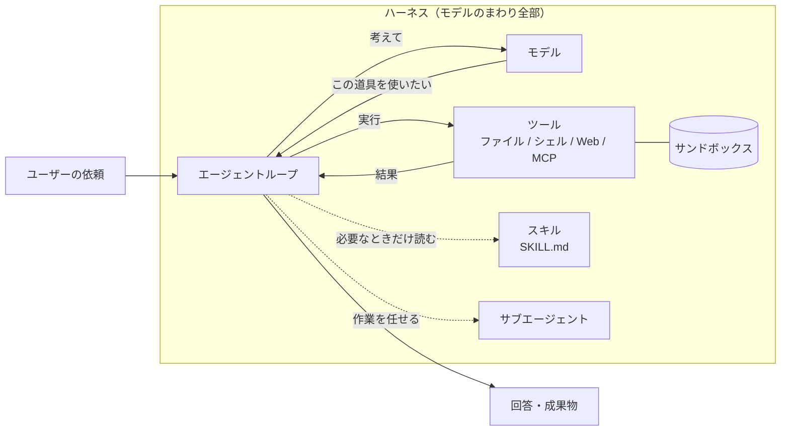
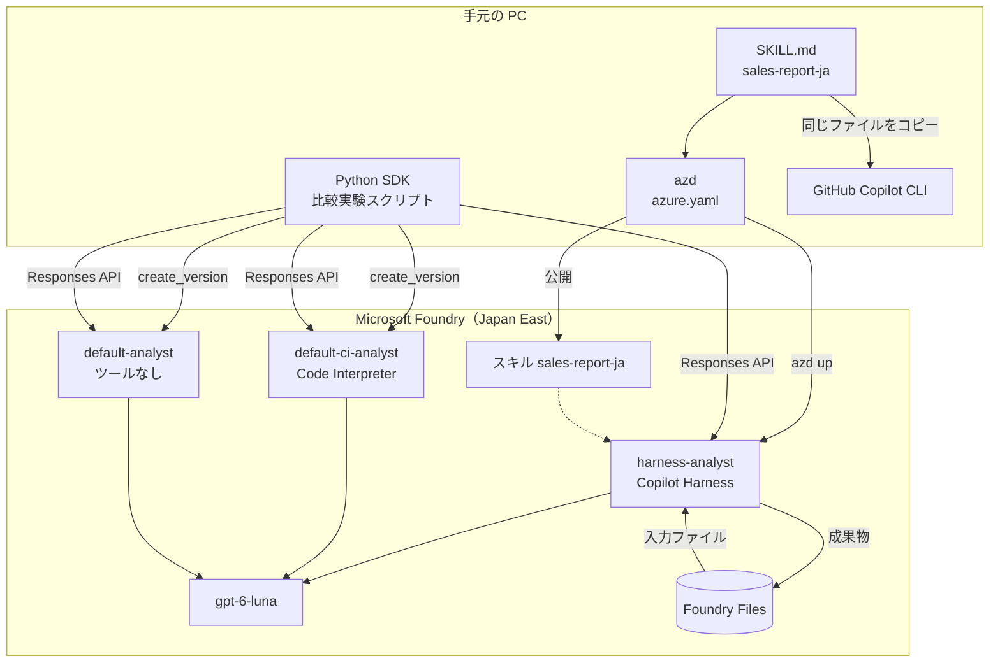
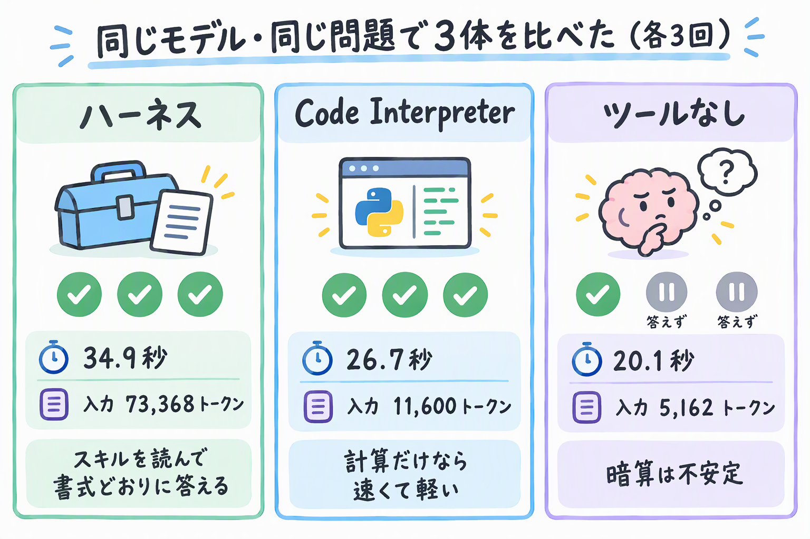
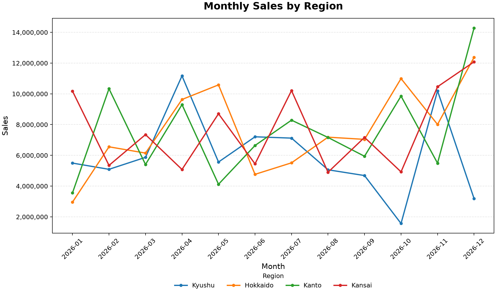

# はじめに

2026年10月28日に、Microsoftが「**Microsoft Copilot Harness**」を発表しました。GitHubのチームが作り、GitHub CopilotやCopilot Studioの裏側で動いているエージェントの実行基盤です。これがMicrosoft Foundryでも使えるようになりました（パブリックプレビュー）。

https://devblogs.microsoft.com/foundry/microsoft-copilot-harness-in-foundry/

発表を読んで最初に思ったのは、「ハーネスって結局なに？モデルとは何が違うの？」でした。しかもFoundry、GitHub Copilot、Copilot Studioと、いろんな製品の名前が一緒に出てきます。なので、どれとどれが同じもので、使う側に何が嬉しいのかを、調べて整理してみました。

調べるだけだと実感がわかないので、実際にFoundryにハーネス付きのエージェントを作って、ハーネスなしのエージェントと同じ問題を解かせて比べてもいます。

> Microsoft Copilot Harnessは、モデルのまわりにある「考える→道具を使う→結果を見る→また考える」の繰り返しを丸ごと引き受けてくれる、GitHub生まれのエージェント実行基盤です。

この記事でやることは次のとおりです。

| やること | 内容 |
|------|------|
| 整理 | ハーネスとは何か、Microsoftのどの製品で使われているか |
| 作成 | azd（Azure Developer CLI）でFoundryにハーネス付きのエージェントを作る |
| 比較 | 同じモデルで「ハーネスあり」「ハーネスなし」「Code Interpreter付き」に同じ問題を解かせる |
| 移植 | Foundry用に書いたスキル（作業手順を書いたSKILL.md）を、そのままGitHub Copilot CLIで動かす |
| 比較 | AWS、OpenAI、Anthropic、LangChain、Googleのハーネスと比べて、何が違うのか |
| 整理 | Foundry、GitHub Copilot、Copilot Studio・Microsoft 365の立場ごとに、何が嬉しいのか |

AzureやFoundryを少し触ったことがある人なら読めるように書いています。エージェントを自作した経験はなくても大丈夫です。

:::message alert
本記事の内容は **2026年10月31日時点** の情報に基づいています。FoundryのCopilot Harnessはパブリックプレビューのため、仕様や料金は変わる可能性があります。
:::

## 参考情報

https://blogs.microsoft.com/blog/2026/10/28/introducing-the-microsoft-copilot-harness-unlocking-the-potential-of-truly-multi-model-agentic-work/
https://learn.microsoft.com/azure/foundry/agents/how-to/use-tools-skills-copilot-harness
https://github.com/microsoft-foundry/foundry-samples/tree/main/samples/cli/prompt-agents/microsoft-copilot-harness

---

# そもそも「ハーネス」って？

ハーネス（harness）は、もともと馬具のことです。馬がどれだけ力持ちでも、馬具がなければ荷車は引けませんし、御者が向きを変えることもできません。馬の力を仕事に変えて、しかも人が制御できるようにする道具が馬具です。

AIエージェントでいうと、**馬がモデル**、**馬具がハーネス**です。Microsoftの発表でも「the harness is everything around the model（ハーネスはモデルのまわりにあるもの全部）」と説明しています。


モデル単体ができるのは「テキストを受け取って、テキストを返す」ことだけです。エージェントとして仕事をさせるには、まわりに次のような仕組みがいります。

| ハーネスが受け持つこと | 具体的には |
|------|------|
| エージェントループ | モデルに考えさせる → ツールを呼ぶ → 結果をモデルに返す、をタスクが終わるまで繰り返す |
| ツール | ファイルの読み書き、シェル、Web取得、MCPサーバーなどを呼べるようにする |
| 実行環境 | コードやコマンドを安全に動かせる隔離された場所（サンドボックス）を用意する |
| コンテキスト管理 | 長い作業でも、モデルに渡す情報があふれないように整理する |
| スキル・サブエージェント | 手順書を必要なときだけ読み込む、作業の一部を別のエージェントに任せる |
| 失敗からの立て直し | ツールが失敗したら、やり方を変えてもう一度試す |

図にすると、こんな感じです。



自分でエージェントを作ったことがある方は、このループをLangChainやSemantic Kernel、Agent Frameworkで組んだ経験があると思います。動くものはすぐできるんですよね。ただ、ツールが失敗したときのリトライ、長い会話のコンテキスト整理、コードを安全に動かす場所の確保まで作り込むのは、かなり大変です。

## ハーネスでそんなに変わるの？

Copilot Studioのチームが、同じタスクを「標準のハーネス」と「Microsoft Copilot Harness」で解かせた社内評価を公開しています。

| 指標 | 標準ハーネス | Microsoft Copilot Harness |
|------|------|------|
| 評価の合格率 | 基準 | OpenAIのモデルで +10.8ポイント、Anthropicのモデルで +22.1ポイント |
| ツールの呼び出しが失敗したあとも解決を試み続けた割合 | 7% 未満 | 84〜91% |
| 入力処理の実質コスト | 基準 | 15〜21% 減（モデルの呼び出しは約2倍に増えたが、キャッシュが効いた） |

https://www.microsoft.com/en-us/copilot/blog/copilot-studio/the-github-copilot-harness-in-copilot-studio-is-now-the-microsoft-copilot-harness/

同じモデルのままハーネスを変えるだけで、合格率が10〜20ポイント以上変わったのは興味深いです。ブログには「モデルを変えてもほとんど差はなかった」とも書いてありました。馬を変えるより、馬具を良くしたほうが荷車は速く進む、ということですね。

---

# Microsoft Copilot Harnessの正体

## GitHub生まれで、いまはMicrosoftのあちこちで動いている

Microsoft Copilot Harnessは、もともとGitHubのエンジニアリングチームがGitHub Copilotのために作ったものです。発表によると、いまは次の製品がこのハーネスで動いています。

- GitHub Copilot app
- GitHub Copilot CLI
- VS Code（GitHub Copilotのエージェント）
- Copilot Studio
- Copilot Code（発表記事に名前だけ出てきます。Microsoft Learnにはまだ説明が見当たりませんでした）

そして今回、これがMicrosoft Foundryで使えるようになりました。発表では、ほかにもこんな特徴が挙がっていました。

- 20以上のモデルと、BYOK（Bring Your Own Key。モデルの提供元と自分で契約したAPIキーを持ち込むこと）に対応していて、タスクに応じてモデルを振り分けられる
- ランタイムをRustで書き直して、セッションの立ち上げと最初のトークンが返るまでの時間を短くした
- SDKがGitHubで公開されている（github.com/github/copilot-sdk）

https://blogs.microsoft.com/blog/2026/10/28/introducing-the-microsoft-copilot-harness-unlocking-the-potential-of-truly-multi-model-agentic-work/

## 製品ごとの関係を整理する

いろんな製品名が出てくるので、図と表にまとめます。


| 製品 | ハーネスとの関係 | 誰が動かすか |
|------|------|------|
| GitHub Copilot（CLI / VS Code / app） | ハーネスの生まれ故郷。コーディングエージェントとして動く | 自分のPCやクラウド上でCopilotが動かす |
| Copilot SDK | 同じハーネスを自分のアプリに組み込むためのSDK | 自分で動かす |
| Copilot Studio | 「GitHub Copilot harness」として提供されていたものが「Microsoft Copilot harness」に改名された | Microsoft（Copilot Creditsで課金） |
| Microsoft Foundry | プロンプトエージェントの実行環境として選べるようになった（プレビュー） | Microsoft（サンドボックスの利用量で課金） |
| Microsoft 365 Copilot | 本体が使っているという記載はない。Copilot Studio経由で使える | - |

Microsoft 365 Copilotについては、公式の発表記事を3つ読みましたが、本体がこのハーネスで動いているという記述はありませんでした。

ただ、Copilot Studioのドキュメントによると、Microsoft 365 Copilotのライセンスがあれば、ハーネスで動くエージェントをCopilot Studioで作ってTeamsなどに公開できます。Microsoft 365を使っている人は、Copilot Studioのエージェントを通してハーネスに触れることになります。

https://learn.microsoft.com/microsoft-copilot-studio/billing-licensing
https://learn.microsoft.com/microsoft-copilot-studio/agents-overview

もう1つ、勘違いしやすい点があります。名前に「GitHub Copilot」と入っていても、Copilot Studioで動くエージェントのデータがGitHub Copilotのサービスに送られるわけではありません。共有しているのは技術とSDKの部品です。Copilot Studioのプライバシーやデータの保存場所のルールはそのまま適用される、とドキュメントにはっきり書いてあります。

https://learn.microsoft.com/microsoft-copilot-studio/agents-experience/overview

## 「20以上のモデル」と「BYOM非対応」は矛盾しない？

調べていて混乱したのがここです。発表では「20以上のモデルとBYOKに対応」とあるのに、Foundryのドキュメントには「Copilot HarnessではBYOM（自分のモデルの持ち込み）は非対応」とあります。

これは、話している場所が違うだけでした。

- 「20以上のモデル + BYOK」は、ハーネス本体（GitHub CopilotやSDK）の話
- 「BYOM非対応」は、Foundryのプレビュー版の話。Foundryでは、プロジェクトにデプロイした「推論とツール呼び出しに対応したモデル」から選ぶ

ちなみにBYOKはキー（契約）の持ち込みで、BYOM（Bring Your Own Model）はFoundryの外にあるモデルそのものの持ち込みです。持ち込むものが違います。

https://learn.microsoft.com/azure/foundry/agents/concepts/limits-quotas-regions#microsoft-copilot-harness-preview

---

# Foundryで何が変わるのか

## エージェントの作り方が3通りになった

Foundryでエージェントを作る方法は、これまでの「プロンプトエージェント」と「ホステッドエージェント」の2つに、「ハーネス付きのプロンプトエージェント」が加わって3つになりました。

| 作り方 | 向いているケース | 自分で用意するもの |
|------|------|------|
| プロンプトエージェント（既定） | 指示とFoundryのツールだけで足りる、シンプルなタスク | 指示、ツール |
| プロンプトエージェント + Copilot Harness | スキル、ファイル、シェル、サブエージェントを使う何ステップもの作業 | 指示、ツール、スキル |
| ホステッドエージェント | フレームワーク、エージェントループ、ミドルウェアを自分で持ちたい | コード一式（コンテナ） |

料理でたとえると、プロンプトエージェントは「レシピを渡して作ってもらう」、ホステッドエージェントは「自分の厨房と道具を持ち込む」です。ハーネス付きは「レシピを渡すと、Microsoftが用意した設備の整った厨房で、料理人が下ごしらえから盛り付けまで自分で段取りしてくれる」イメージです。


## ハーネスを選んでも変わらないもの

ハーネスを選んでも、エージェントの種類は「プロンプトエージェント」のままです。ここは、うまい作りだなと思いました。

| 変わらないもの | 内容 |
|------|------|
| エージェントの種類 | プロンプトエージェントのまま。ハーネスの指定が1つ増えるだけ |
| 定義の書き方 | モデル、指示、ツールを設定する |
| 呼び出し方 | Responses API。アプリ側のコードはほぼそのまま |
| IDとガバナンス | Foundryのロール、エージェントID、接続、ポリシーがそのまま効く |
| 運用 | ハーネスの実行環境はFoundryが運用する。自分で管理するリソースは増えない |

※ Responses APIは、Foundryのエージェントやモデルを呼び出すためのOpenAI互換のAPIです。

定義に足すのは、本当にこの1項目だけです。

```yaml
harness:
  type: microsoft_copilot_preview
```

## ハーネスについてくる5つの道具

ハーネスを選ぶと、次の5つのツールが最初から使えます（既定ですべて有効）。

| ハーネスのツール | 設定名 | できること |
|------|------|------|
| ファイル読み取り | `filesystem_read` | ワークスペースのファイルを読む、検索する |
| ファイル書き込み | `filesystem_write` | ワークスペースにファイルを作る、書き換える |
| シェル | `shell` | OSのコマンドを実行する |
| Web | `web` | URLを指定して中身を取ってくる |
| サブエージェント | `subagents` | 作業の一部を別のエージェントに任せる |

https://learn.microsoft.com/azure/foundry/agents/how-to/use-tools-skills-copilot-harness

このほかに、スキル、Functionツール、FoundryのWeb検索、MCPツールなどを足せます。

:::message
シェルがいちばん強いツールです。ファイルの読み書きやWebを無効にしても、シェルが有効なら`cat`や`curl`で同じことができてしまいます。ドキュメントにも「シェルを残したまま他を無効にしても、厳密なセキュリティ境界にはならない」とあります。通信を絞りたいときは、サンドボックスから外への通信（エグレス）を許可リストで制限する機能（プレビュー）を使います。
:::

## 会話ごとに作業机がつく

ハーネスは、会話（conversation）ごとに専用の**ワークスペース**を用意します。ファイルや実行の途中経過はここに置かれます。実際にコマンドが動くのは、Foundryが管理する隔離された**サンドボックス**です。

オフィスでたとえると、会話ごとに専用の作業机が割り当てられて、作業はMicrosoftが管理する作業部屋で行う、という感じです。しばらく使わないと部屋は片付けられますが（アイドル）、机の上のもの（ワークスペース）は戻ってきたときにそのまま残っています。


ただし、サンドボックスは成果物を長く保存する場所ではありません。大事なファイルはFoundry Filesなどに保存しておくように、とドキュメントにあります。新しい会話を始めると、机も別のものになります。

---

# 実際に動かしてみる

ここからは、実際にFoundryにハーネス付きのエージェントを作ってみます。

## 今回の構成

Japan Eastに新しいFoundryプロジェクトを作り、モデルは`gpt-6-luna`を使います。同じモデル、同じ指示で、エージェントを3体用意しました。

| エージェント | 実行環境 | ツール・スキル | 作り方 |
|------|------|------|------|
| `harness-analyst` | Copilot Harness | ハーネスの5つのツール + スキル`sales-report-ja` | azd |
| `default-ci-analyst` | 既定 | Code Interpreter | Python SDK |
| `default-analyst` | 既定 | なし | Python SDK |

Code Interpreterは、既定のプロンプトエージェントにも付けられる「Pythonを実行するツール」です。これもサンドボックスでコードを動かすので、ハーネスと似ています。違いは、Code Interpreterが「Pythonを動かす道具を1つ足す」だけなのに対して、ハーネスはスキル、シェル、ファイル、サブエージェントを使うループ全体を受け持つところです。この差が結果にどう出るかを見てみます。



記事中のコードは、説明に必要なところだけの抜粋です。

## 前提条件

| 項目 | 内容 |
|------|------|
| Azure | サブスクリプションと、リソースグループを作れる権限 |
| ロールの割り当て | 検証2でエージェントにロールを付けるため、所有者かロールベースのアクセス制御管理者などの権限 |
| リージョン | ハーネスの対応リージョン（今回はJapan East） |
| モデル | 推論とツール呼び出しに対応したモデル（今回は`gpt-6-luna`） |
| azd | 1.37.0以上と、Foundry拡張の`azure.ai.agents` 1.0.0-beta.22以上 |
| Python | `azure-ai-projects` 2.9.0以上（今回は2.10.0）、`azure-identity` |
| GitHub Copilot CLI | 検証3で使う。GitHub Copilotの契約が必要 |

## Step 1: azdとFoundry拡張を用意する

手元のazdが1.28だったので、まず更新しました。Windowsではwingetを使います。

```powershell
winget upgrade Microsoft.Azd
```

macOSなら`brew upgrade azd`です。続いてFoundry拡張を入れます。`microsoft.foundry`を入れると、`azure.ai.agents`や`azure.ai.skills`なども一緒に入ります。

```bash
azd extension install microsoft.foundry
azd extension update microsoft.foundry
azd extension list --installed
```

こんな感じになればOKです。

```text
azure.ai.agents        Foundry agents (Beta)     Up to date   1.0.0-beta.23
azure.ai.projects      Foundry Projects (Beta)   Up to date   1.0.0-beta.16
azure.ai.skills        Foundry skills (Beta)     Up to date   1.0.0-beta.10
microsoft.foundry      Microsoft Foundry (Beta)  Up to date   1.0.0-beta.4
```

もう1つ、ハーネスのプレビュー機能を有効にする環境変数を設定します。シェルを開き直すたびに必要です。

```bash
# bash
export AZD_ALPHA_ENABLE_AGENTS_MANAGED_HARNESS=true
```

```powershell
# PowerShell
$env:AZD_ALPHA_ENABLE_AGENTS_MANAGED_HARNESS = "true"
```

## Step 2: ハーネス付きのエージェントのひな形を作る

`azd ai agent init`に`--harness`オプションがあるので、これを付けて初期化します。

```bash
azd ai agent init harness-analyst \
  --no-prompt \
  --kind prompt \
  --agent-name harness-analyst \
  --model gpt-6-luna \
  --harness microsoft_copilot_preview \
  --instructions "You are a careful data analyst."
```

実行すると、対応リージョンも教えてくれます。

```text
The Microsoft Copilot harness requires a Foundry project in one of these regions: australiaeast, canadacentral, centralus, germanywestcentral, japaneast, swedencentral, uksouth, westeurope, westus.

Initialized prompt agent "harness-analyst".
  Harness:       microsoft_copilot_preview
```

Japan Eastが入っているのは嬉しいですね。

## Step 3: スキルを書く

スキルは、手順書をフォルダにまとめたものです。`SKILL.md`の先頭に名前と説明を書き、本文に手順を書きます。今回は「売上データを集計して、決まった書式でレポートにする」スキルを作りました。

```markdown:skills/sales-report-ja/SKILL.md
---
name: sales-report-ja
description: 売上データ（CSV）を集計して、日本語の売上レポートを決まった書式で作る。売上の集計、地域別・商品別の比較、月次の推移を聞かれたときに使う。
---

# 売上レポート（日本語）

売上データを集計してレポートを書くときは、次の手順に従う。

## 集計のルール

1. 数値は頭の中で計算しない。必ずコード（Python など）で CSV を読み込んで計算する。
2. 売上金額は `units * unit_price * (1 - discount_rate)` で行ごとに求めてから合計する。
3. 合計値は、地域別の合計を足した値と、全行を直接足した値の2通りで検算し、一致を確認する。
4. 金額は円単位に四捨五入し、3桁区切り（例: 12,345,678円）で書く。

## レポートの書式

次の見出しで、この順に書く。

- `## 結論`: 質問への答えを2〜3行で
- `## 集計結果`: Markdown の表で
- `## 検算`: 2通りの合計値と、一致したかどうか
- `## 前提と注意`: 計算式、欠損値の扱いなど

推測や補完をした値には「（推定）」と書く。データに無い列や値を作らない。
```

ツールとスキルの違いは、「道具」と「作業マニュアル」の違いだと考えると分かりやすいです。シェルやWeb検索は道具で、スキルは「この仕事はこの順番で、この道具を使ってやる」という社内マニュアルです。新人さんにマニュアルを全部暗記させるのではなく、該当する仕事が来たときに開いてもらう、そんなイメージです。

## Step 4: azure.yamlにスキルとハーネスを書く

生成された`azure.yaml`に、モデルのデプロイとスキルを足します。

```yaml:azure.yaml
infra:
    provider: microsoft.foundry
name: harness-analyst
services:
    ai-project:
        host: azure.ai.project
        deployments:
            - name: gpt-6-luna
              model:
                  format: OpenAI
                  name: gpt-6-luna
                  version: '2026-09-22'
              sku:
                  name: GlobalStandard
                  capacity: 200

    # 再利用できるスキル（SKILL.md を含むフォルダをそのまま公開する）
    sales-report-ja:
        host: azure.ai.skill
        uses:
            - ai-project
        archive: ./skills/sales-report-ja

    # Copilot Harness を使うプロンプトエージェント
    harness-analyst:
        host: azure.ai.agent
        project: .
        kind: prompt
        name: harness-analyst
        model: gpt-6-luna
        harness:
            type: microsoft_copilot_preview
        instructions: |
            あなたは慎重なデータアナリストです。売上データの質問には、添付のスキル sales-report-ja に従って答えてください。
            数値を推測で書かず、根拠を示してください。
        skills:
            - sales-report-ja
        uses:
            - ai-project
            - sales-report-ja
```

ポイントは3つです。

- `harness.type: microsoft_copilot_preview`で、ハーネスを選ぶ
- スキルは`host: azure.ai.skill`の別サービスとして書き、`archive`に`SKILL.md`のあるフォルダを指定する
- エージェントの`skills`でスキルを付け、`uses`でスキルを先にデプロイさせる

## Step 5: デプロイして確認する

リージョンなどを設定して、`azd up`します。

```bash
azd env set AZURE_LOCATION japaneast
azd env set AZURE_RESOURCE_GROUP rg-copilot-harness-poc
azd env set AZURE_AI_PROJECT_NAME copilot-harness-poc
azd up --no-prompt
```

リソースグループ、Foundry、プロジェクト、モデルのデプロイ、スキル、エージェントまで、1回でできあがります。このあとのスクリプトで使うプロジェクトのエンドポイントは、`azd env get-value FOUNDRY_PROJECT_ENDPOINT`で取れます。

デプロイ後、`azd ai agent show`で中身を見ると、ハーネスとスキルが付いていました。

```json
"definition": {
  "harness": { "type": "microsoft_copilot_preview" },
  "kind": "prompt",
  "model": "gpt-6-luna",
  "skills": [ { "name": "sales-report-ja", "version": "1" } ]
}
```

スキルにはバージョン番号が付いています。スキルを書き換えて再デプロイすると新しいバージョンになり、エージェントのバージョンごとに「どのバージョンのスキルを使うか」が固定されます。スキルをコードと同じようにバージョン管理できるわけです。

:::message alert
**azdで`uses`にスキルを書くと、スキルまで付いてしまった**

最初は比較用の2体も同じ`azure.yaml`に書いていました。するとazdに「`uses`に`sales-report-ja`を書け」と怒られたので、比較用の2体の`uses`にスキルを足しました。ところが、デプロイ後の定義を見ると、`skills`に書いていない2体にも`sales-report-ja`が付いていました。

ドキュメントには「`uses`に書いても、それだけではエージェントに付かない」とあるので、少なくとも`azure.ai.agents` 1.0.0-beta.23では、ドキュメントと動きが違うようです。比較の条件が揃わなくなるので、比較用の2体は`azure.yaml`から外し、Python SDKでスキルなしのバージョンを作り直しました。
:::

比較用の2体を作るSDKのコードはこんな感じです。

```python:scripts/create_baselines.py
import os

from azure.ai.projects import AIProjectClient
from azure.ai.projects.models import CodeInterpreterTool, PromptAgentDefinition
from azure.identity import DefaultAzureCredential

ENDPOINT = os.environ["FOUNDRY_PROJECT_ENDPOINT"]
INSTRUCTIONS = "あなたは慎重なデータアナリストです。\n数値を推測で書かず、根拠を示してください。\n"

project = AIProjectClient(endpoint=ENDPOINT, credential=DefaultAzureCredential(), allow_preview=True)

# 既定の実行環境、ツールなし
project.agents.create_version(
    agent_name="default-analyst",
    definition=PromptAgentDefinition(model="gpt-6-luna", instructions=INSTRUCTIONS),
)
# 既定の実行環境 + Code Interpreter
project.agents.create_version(
    agent_name="default-ci-analyst",
    definition=PromptAgentDefinition(
        model="gpt-6-luna", instructions=INSTRUCTIONS, tools=[CodeInterpreterTool()]
    ),
)
```

ちなみにSDKでハーネスを付けるときは、`PromptAgentDefinition(harness=MicrosoftCopilotHarness())`と書きます。SDKの中を見てみたら、`MicrosoftCopilotHarness`と並んで`GitHubCopilotHarness`というクラスも残っていました。改名の名残ですね。

## 動作確認: 使える道具を聞いてみる

3体それぞれに、新しい会話で「あなたが使えるツールを全部教えて」と聞いてみました。ハーネス付きのエージェントは、ワークスペースが会話ごとに用意されるので、先に会話（conversation）を作ってから呼びます。

```python:scripts/smoke.py
# name はエージェント名（harness-analyst など）
openai = project.get_openai_client(agent_name=name)
conv = openai.conversations.create()
res = openai.responses.create(
    conversation=conv.id,
    input="あなたが使えるツールを全部、名前だけ箇条書きで教えてください。",
)
```

結果はこうでした。

| エージェント | 答えたツールの数 | 入力トークン |
|------|------|------|
| `harness-analyst` | 15個 | 11,907 |
| `default-ci-analyst` | 2個（`python.exec`、`python_user_visible.exec`） | 713 |
| `default-analyst` | なし | 61 |

ハーネス付きが答えた15個は次のとおりです。

```text
bash, view, web_fetch, skill, task, read_agent, list_agents, write_agent,
task_complete, download_file_from_foundry_project_to_workspace,
upload_file_from_workspace_to_foundry_project, apply_patch, rg, glob,
multi_tool_use.parallel
```

「5つの道具」と言っていたのに15個あるのは、設定名1つの中に実際の道具がいくつも入っているからです。名前から見ると、だいたいこう対応していそうです。

| 設定名 | 実際の道具（推測） |
|------|------|
| `shell` | `bash` |
| `filesystem_read` | `view`、`rg`、`glob` |
| `filesystem_write` | `apply_patch` |
| `web` | `web_fetch` |
| `subagents` | `task`、`read_agent`、`list_agents`、`write_agent` |
| スキル | `skill` |
| Foundry Files連携 | `download_file_from_...`、`upload_file_from_...` |
| そのほか（用途は未確認） | `task_complete`、`multi_tool_use.parallel` |

`apply_patch`、`rg`、`glob`あたりは、GitHub Copilotのコーディングエージェントでおなじみの道具ですね。本当にGitHub Copilotと同じハーネスなんだなと実感しました。

ただ、気になったのは入力トークンです。同じ一言の質問なのに、ハーネス付きは11,907トークンでした。ツールの定義やハーネスの指示を毎回モデルに渡しているので、これがハーネスの「固定費」になります。

## 検証1: 同じモデルで、ハーネスあり・なしを比べる

いよいよ本題です。240行の売上データ（CSV）をプロンプトに貼り付けて、3体に同じ質問をしました。

- 全体の売上合計
- 地域別の売上合計と、いちばん大きい地域
- 前月からの増加額がいちばん大きい月と、その金額
- 上期から下期への伸び率がいちばん大きい商品と、その伸び率

データは、関西（91,848,466円）と北海道（91,740,102円）の差が約11万円しかないように作ってあります。暗算だと間違えやすいデータです。正解は手元のPythonで計算しておき、回答の最後に出させたJSONと突き合わせて採点しました。各エージェント3回ずつ、新しい会話で試しています。

結果はこうなりました。

| エージェント | 全問正解 | 答えなかった | 間違えた | 所要時間 中央値（範囲） | 入力トークン 中央値 |
|------|------|------|------|------|------|
| `harness-analyst`（ハーネス） | 3回 | 0回 | 0回 | 34.9秒（34.8〜36.7） | 73,368 |
| `default-ci-analyst`（Code Interpreter） | 3回 | 0回 | 0回 | 26.7秒（15.4〜29.2） | 11,600 |
| `default-analyst`（ツールなし） | 1回 | 2回 | 0回 | 20.1秒（16.9〜94.1） | 5,162 |

※ 2026年10月31日、Japan East、`gpt-6-luna`、各3回の結果です。回数が少ないので、傾向として見てください。

結果を図にすると、こうなります。



正直に言うと、「計算を正しくやる」だけなら、Code Interpreter付きのエージェントで十分でした。全問正解で、ハーネス付きより速く、入力トークンは約6分の1です。

ツールなしのエージェントは、回によって動きが変わりました。1回目は、推論だけで94秒かけて全問正解（出力トークンは16,795）。2回目と3回目は「この環境ではCSVを集計できないため、数値を推測して回答することは避けます」と言って、集計用のPythonコードだけを返しました。指示の「推測で書かない」には忠実なんですが、結果が安定しません。

### じゃあハーネスは何が違ったのか

ハーネス付きのエージェントの出力を見ると、3回とも次の順番で動いていました。

```text
function_call  skill {"skill": "sales-report-ja"}     ← まずスキルを読み込む
function_call_output  Skill "sales-report-ja" loaded successfully.
shell_call     python - <<'PY' ...                    ← シェルで Python を動かして集計
shell_call_output  rows 240 / direct 346172503 / regions ...
message        ## 結論 ...                             ← スキルの書式で回答
```

違いが分かりやすいのは、回答の書式です。Code Interpreter付きのほうは、正しい数字を箇条書きで返してくれました。

```markdown
1. **全体の売上合計：346,172,503円**
2. **地域別の売上合計**
   - 北海道：91,740,102円
   ...
```

ハーネス付きのほうは、スキルに書いたとおり「結論、集計結果、検算、前提と注意」の4つの見出しで、検算まで入れて返してきました。

```markdown
## 結論
全体の売上合計は **346,172,503円** です。地域別では **関西** が最大で、...

## 集計結果
| 地域 | 売上合計 |
|---|---:|
| 関西 | 91,848,466円 |
...

## 検算
全行を直接合計した売上は346,172,503円、地域別売上合計の合計も346,172,503円で、一致しました（240行）。

## 前提と注意
各行の売上を `units × unit_price × (1 − discount_rate)` で計算し、...
```

指示（instructions）には「スキルに従って」としか書いていません。書式や検算のやり方はスキルの中にあって、ハーネスがそれを読みに行って守っています。チームの「レポートの書き方」をスキルにしておけば、誰がエージェントを作っても同じ品質で出てくる、というのがハーネスとスキルの組み合わせの良さだと思います。

あと、3回目の実行では、スキルを読んだあとに`glob`で`**/AGENTS.md`を探していました。GitHub Copilotのコーディングエージェントが、リポジトリの`AGENTS.md`を探しに行くのと同じ動きです。こういうところにGitHub生まれっぽさが出ますね。

入力トークンが多いのは、ハーネスが内部でループを回しているからです。スキルを読む、シェルを動かす、結果を見る、のたびにモデルを呼び直すので、1回の質問でもトークンは積み上がります。冒頭のCopilot Studioの評価でも「モデルの呼び出しは約2倍に増えた」とあったので、同じ傾向ですね。

## 検証2: ファイルを渡して、グラフを返してもらう

ハーネスの得意分野は、ファイルを扱う作業です。今度はCSVをプロンプトに貼らず、Foundry Filesにアップロードしてファイルとして渡しました。そのうえで「地域別の月次売上の折れ線グラフをPNGで作って」と頼んでいます。公式サンプルのCSV Chart Analystと同じ流れです。

https://github.com/microsoft-foundry/foundry-samples/tree/main/samples/cli/prompt-agents/microsoft-copilot-harness/csv-chart-analyst

その前に、1つ準備がいります。ハーネスが作ったファイルは、エージェント自身のIDでFoundry Filesにアップロードされます。なので、エージェントの`instance_identity.principal_id`に、プロジェクトのFoundry Userロールを付けます。

```bash
# principal_id は azd ai agent show の instance_identity.principal_id
# Git Bash ではパスが書き換えられるので MSYS_NO_PATHCONV=1 を付ける
MSYS_NO_PATHCONV=1 az role assignment create \
  --assignee-object-id "<agent-principal-id>" \
  --assignee-principal-type ServicePrincipal \
  --role "53ca6127-db72-4b80-b1b0-d745d6d5456d" \
  --scope "<Foundry プロジェクトのリソース ID>"
```

※ Foundryのロールは名前が変わったばかりなので、ロール名ではなくID（`53ca6127-...`がFoundry User）で指定するように、とドキュメントに書いてあります。反映には最大5分ほどかかります。

ファイルを渡すコードはこんな感じです。

```python:scripts/chart.py
# project は Step 5 の create_baselines.py と同じ AIProjectClient。PROMPT はグラフ作成の依頼文
csv_path = Path("data/sales_2026.csv")
files_client = project.get_openai_client()                     # プロジェクトの Files API
agent_client = project.get_openai_client(agent_name="harness-analyst")

with csv_path.open("rb") as f:
    uploaded = files_client.files.create(file=(csv_path.name, f, "text/csv"), purpose="assistants")
conv = agent_client.conversations.create()
res = agent_client.responses.create(
    conversation=conv.id,
    input=[{
        "role": "user",
        "content": [
            {"type": "input_text", "text": PROMPT},
            {"type": "input_file", "file_id": uploaded.id},   # ファイルを添付
        ],
    }],
)
```

返ってきた回答の最後には、ファイル名とFoundry FilesのファイルIDが書かれていました。

```text
File: monthly_sales_by_region.png
Download ID: assistant-Hn6EJLmdTUBW1fjLsXLJSD
```

このIDを使って、プロジェクトのFiles APIからダウンロードします。

```python
# 実際のスクリプトでは、回答の Download ID や file_citation の注釈から ID を拾っている
data = files_client.files.content("assistant-Hn6EJLmdTUBW1fjLsXLJSD").read()
Path("monthly_sales_by_region.png").write_bytes(data)
```

44.5秒で、こんなグラフが返ってきました。



値も手元で確かめました。たとえば関東の12月（14,280,872円）や九州の10月（1,567,252円）が、グラフの点と合っていました。

途中の動きも追ってみました。出力の記録を見ると、こんな流れです。

1. スキル`sales-report-ja`を読み込む
2. `view`で`/home/session/workspace/data/sales_2026.csv`を開く。添付ファイルはここに自動で置かれていた
3. `matplotlib`をimportしようとして失敗する
4. 自分で`pip install matplotlib`する
5. グラフを描くが、日本語フォントがなく地域名が描けないと警告が出る
6. 地域名を英語（Kanto、Kansaiなど）に変えて描き直す
7. スキルのとおり、2通りの合計で検算する（`verified=True`）
8. `upload_file_from_workspace_to_foundry_project`でPNGをFoundry Filesに上げる

ライブラリがない、フォントがない、と2回つまずいていますが、どちらも自分で立て直して最後までやり切っています。冒頭の「ツールが失敗したあとも解決を試み続けた割合84〜91%」は、まさにこういう動きのことなんだろうなと思いました。

しかも、グラフを頼んだだけなのに、スキルの「2通りで検算する」もちゃんと守っています。これ、地味にすごいと思います。

この1回の入力トークンは161,501で、そのうち139,699がキャッシュでした。ループを何周も回るので量は増えますが、前の周の内容はほとんどキャッシュが効くようです。

## 検証3: 同じSKILL.mdをGitHub Copilot CLIでも動かす

最後に、Foundry用に書いた`SKILL.md`を、手元のGitHub Copilot CLIでも使えるか試しました。同じハーネスなら、スキルもそのまま使えるはずです。

GitHub Copilot CLIは、`.github/skills/`、`.agents/skills/`、`.claude/skills/`などに置いた`SKILL.md`を読み込みます。なので、空のフォルダを作って、Foundry用のファイルをそのままコピーしました。

```bash
mkdir -p copilot-cli-local/.github/skills/sales-report-ja copilot-cli-local/data
cp harness-analyst/skills/sales-report-ja/SKILL.md copilot-cli-local/.github/skills/sales-report-ja/
cp harness-analyst/data/sales_2026.csv copilot-cli-local/data/
cd copilot-cli-local
copilot skill list
```

```text
  sales-report-ja - 売上データ（CSV）を集計して、日本語の売上レポートを決まった書式で作る。...
```

認識されました。この状態で、Copilot CLIに頼んでみます。

```bash
copilot -p "data/sales_2026.csv の売上レポートを作ってください。全体合計、地域別合計と最も売上が大きい地域を知りたいです。" \
  --allow-all-tools --trust-folder
```

```text
● skill(sales-report-ja)

● 集計して売上レポートの数値を検算 (shell)
  │ import csv
  │ from decimal import Decimal, ROUND_HALF_UP
  └ 51 lines…

## 結論
全体の売上合計は **346,172,503円** です。
地域別では **関西が91,848,466円で最も大きい** 売上となっています。

## 集計結果
| 地域 | 売上合計 |
|---|---:|
| 関西 | 91,848,466円 |
...

## 検算
- 全行を直接合計: **346,172,503円**
- 地域別合計を合算: **346,172,503円**
- 検算結果: **一致**

## 前提と注意
...
```

Foundryのときと同じように、最初に`skill(sales-report-ja)`を呼び、シェルでPythonを動かし、同じ4つの見出しで、同じ数字を返してくれました（98秒）。

:::message
この検証で確かめたのは、スキルのファイルがそのまま使い回せることです。Copilot CLIが使ったモデルはCopilot側が選んだもので、Foundryの`gpt-6-luna`とは別です。なので、速さや精度の比較にはなっていません。また、`--allow-all-tools`を付けると、Copilot CLIは確認なしに手元のPCでシェルを実行します。試すときは使い捨てのフォルダでやってください。
:::

手元のCopilot CLIでスキルを試して、良くなったら同じファイルをFoundryにデプロイする、という流れが作れるわけです。開発者としては、これがいちばん嬉しいポイントかもしれません。

---

# 料金と制約

## 料金

| 項目 | 内容 |
|------|------|
| ハーネスのランタイム | 2026年12月1日まで無料 |
| 12月1日以降 | サンドボックスの利用量で課金。vCPU 1時間あたりUSD 0.0994、メモリ1GiB 1時間あたりUSD 0.0118 |
| モデルの推論 | これまでどおり、別に課金される |
| Web検索などのツール | ツールごとに別に課金される |

検証1で見たとおり、ハーネスは内部でループを回すので、モデルの入力トークンは増えます。サンドボックスの料金だけでなく、トークンの増え方も見ておいたほうがよさそうです。

## プレビューの制約

| 制約 | 内容 |
|------|------|
| ハーネスは作成時にしか選べない | 既存のエージェントにあとから付けることも、外すこともできない。変えたいときは別のエージェントを作る |
| 対応リージョン | Australia East、Canada Central、Central US、Germany West Central、Japan East、Sweden Central、UK South、West Europe、West US |
| モデル | 推論とツール呼び出しに対応したモデル。BYOMは非対応 |
| サンドボックス | CPU、メモリ、アイドルの設定はFoundryが管理していて、変えられない |
| Foundry Memory | 非対応（会話の履歴やワークスペースのファイルは使える） |
| 会話が必須 | ハーネス付きのエージェントは、毎回conversationを指定して呼ぶ。`previous_response_id`は使えない |
| Functionツール | `strict: true`は非対応 |

https://learn.microsoft.com/azure/foundry/agents/concepts/limits-quotas-regions#microsoft-copilot-harness-preview

---

# ほかのハーネスと比べてみる

ここまでCopilot Harnessだけを見てきましたが、「ベンダーがエージェントループとサンドボックスをまとめて運用してくれる」サービスは、ほかの会社も出しています。気になったので、2026年10月31日時点の公式ドキュメントで調べてみました。

## どの会社も「自分で動かす版」と「運用してもらう版」がある

調べてみて分かったのは、どの会社も同じハーネスを2つの形で出していることです。手元で動かすライブラリやCLIと、クラウドで運用してもらうマネージド版です。

| 会社 | 自分で動かすハーネス | ベンダーが運用するハーネス | 自分のループを載せる実行環境 |
|------|------|------|------|
| Microsoft / GitHub | Copilot SDK、Copilot CLI | FoundryのCopilot Harness、Copilot Studio | Foundryホステッドエージェント |
| AWS | Strands Agents | AgentCore harness | AgentCore Runtime |
| OpenAI | Codex、Agents SDK | Agents API | なし |
| Anthropic | Claude Agent SDK、Claude Code | Claude Managed Agents | なし |
| LangChain | deepagents | Managed Deep Agents | LangSmith Deployment |
| Google | ADK、Gemini CLI / Antigravity CLI | 公式情報では見つからず | Agent Runtime（旧Vertex AI Agent Engine） |

中身を見ると、どれも既存のコーディングエージェントのハーネスをそのまま載せたものでした。OpenAIのAgents APIは「CodexのハーネスをOpenAIが運用するもの」、AWSのAgentCore harnessはStrands Agents、Managed Deep Agentsはオープンソースのdeepagentsが中身です。コーディングエージェントで鍛えたハーネスを、業務エージェントの土台としてAPIで出す、というのが2026年の流れのようです。

https://docs.aws.amazon.com/bedrock-agentcore/latest/devguide/harness-vs-runtime.html
https://developers.openai.com/api/docs/guides/agents-api/overview
https://platform.claude.com/docs/en/managed-agents/overview
https://docs.langchain.com/langsmith/managed-deep-agents

図にすると、こんな感じです。


## マネージドのハーネス同士を比べる

ベンダーが運用してくれるハーネスを並べると、こうなりました。

| 比較軸 | Copilot Harness（Foundry） | AgentCore harness（AWS） | Agents API（OpenAI） | Managed Agents（Anthropic） | Managed Deep Agents（LangChain） |
|------|------|------|------|------|------|
| 成熟度 | プレビュー（2026-10-28） | GA（2026-06-17） | ベータ（2026-09-10） | ベータ（2026-04-08） | ベータ |
| 中身のハーネス | GitHub Copilot | Strands Agents | Codex | Anthropic製 | deepagents |
| サンドボックス | Microsoftが運用。サイズは変えられない | セッションごとのmicroVM。独自コンテナも持ち込める | OpenAI運用 / 自前 / なしから選ぶ。サイズは3段階 | Anthropic運用か、自前のサンドボックス | LangSmithが運用 |
| モデル | Foundryにデプロイしたモデル。BYOM不可 | Bedrock、OpenAI、Geminiなど。会話の途中で切り替え可 | OpenAIのモデル（※） | Claudeのみ | 複数社 |
| 料金 | 12/1まで無料。以降はvCPU時間とメモリ時間 | ハーネス自体は無料。下回りのAgentCoreの従量 | Agents API自体は無料。コンテナ料金 | 1セッション時間あたり$0.08 | 未公表 |
| 日本のリージョン | Japan East | 東京 | なし（データは米国のみ） | 確認できず | 確認できず |

※ OpenAIのAgents APIが他社のモデルを使えないと明記した資料は見つかりませんでした。例がすべてOpenAIのモデルなので、そう判断しています。

https://docs.aws.amazon.com/bedrock-agentcore/latest/devguide/harness.html
https://developers.openai.com/api/docs/guides/agents-api/architecture
https://platform.claude.com/docs/en/about-claude/pricing

### 道具とスキルは、ほぼ横並び

ファイル操作、シェル、SKILL.mdのスキル、MCPは、5つともほぼ同じでした。SKILL.mdはもともとAnthropicが作った形式ですが、いまはagentskills.ioでオープンな規格になっていて、どの会社も対応しています。検証3で同じスキルがCopilot CLIでも動いたように、スキルは会社をまたいでも使い回しやすいはずです。

道具の数そのもので選ぶ時代ではなくなったな、と感じました。

### 差が出るのは、環境をどこまで自分で決められるか

違いがはっきり出たのは、次の3つです。

- **サンドボックス**: Copilot HarnessはCPUやメモリを変えられず、自前の環境にも差し替えられません。仕様を確認できた中では、いちばん手を入れられる範囲が狭いです。OpenAIとAnthropicは自前のサンドボックスに差し替えられ、AWSは独自コンテナを持ち込めます
- **モデル**: いちばん自由なのはAWSで、Bedrock、OpenAI、Geminiなどを会話の途中でも切り替えられます。反対に、AnthropicはClaudeだけ、OpenAIも自社モデル中心です。Copilot Harnessはその中間で、Foundryのカタログには複数社のモデルがありますが、BYOMはできません
- **データの置き場所**: OpenAIのAgents APIはデータの保存先が米国のみで、ZDR（データを保持しない設定）にも対応していません。AnthropicのManaged AgentsもZDRの対象外です。日本のリージョンで使えると確認できたのは、Copilot Harness（Japan East）とAgentCore harness（東京）の2つだけでした

料金は、課金の形がばらばらでした。Anthropicはセッション時間の定額、OpenAIはコンテナの大きさ別、MicrosoftとAWSはvCPUとメモリの時間です。Copilot Harnessはサンドボックスの大きさが公開されていないので、1時間あたりいくらかは、今のところ計算できません。12月1日までの無料期間に、実際の請求を見ておきたいところです。

## Microsoftの中にも入口がいくつかある

MicrosoftとGitHubの中だけでも、同じハーネスに入る方法が複数あります。

| 入口 | 誰がループを動かすか | 状況 |
|------|------|------|
| FoundryのCopilot Harness | Microsoft | プレビュー（2026-10-28） |
| Copilot StudioのCopilot harness | Microsoft | GA。Copilot Creditsで課金 |
| Copilot SDK | 自分 | GA（2026-06-02）。BYOKはキー方式のみ |
| Copilot CLI / Copilot cloud agent | 自分のPC / GitHub | 開発者向け |

おもしろいのは、同じハーネスでもCopilot Studio版はすでにGAで、Foundry版はプレビューという点です。また、Copilot SDKは「Microsoft Copilot SDK」への改名が発表されていて、Microsoft Copilot Harnessをプログラムから使うための窓口という扱いになりました。

Copilot SDKをFoundryのホステッドエージェントに載せると、同じハーネスのまま、CPUやメモリ、モデルを自分で決められます。Copilot Harnessのサンドボックスやモデルの制約に当たったときは、ここが移り先になりそうです。

https://learn.microsoft.com/microsoft-copilot-studio/harnesses-overview
https://github.blog/changelog/2026-06-02-copilot-sdk-is-now-generally-available/
https://github.blog/changelog/2026-10-28-github-copilot-sdk-is-becoming-microsoft-copilot-sdk/
https://learn.microsoft.com/azure/foundry/agents/concepts/hosted-agents

:::message
Microsoft Agent Frameworkにも`HarnessAgent`という名前の部品がありますが、これはAgent Frameworkの部品を組み合わせた別物です。Microsoft Copilot Harnessとつながっていると書かれた資料はありませんでした。名前が同じなので、混同しないように気をつけてください。

https://learn.microsoft.com/agent-framework/concepts/harness
:::

## 比べてみて分かったこと

機能だけで比べると、AWSのAgentCore harnessのほうが先を行っています。GAで、モデルの自由度もガバナンスの作り込みも上です。Azureを使っていない人に、あえてCopilot Harnessを勧める理由は弱いかなと思いました。

一方で、AzureのロールやエージェントID、RAIポリシーの中で、Japan Eastのデータを使って動かせるマネージドハーネスは、今のところCopilot Harnessだけです。Azureを中心に使っている会社にとっては、ここがいちばん大きいポイントだと思います。

※ この節の日付や料金の一部は、公式情報の中で記述が食い違っていたり、二次情報でしか確認できなかったりしました。各社とも更新が速い分野なので、使う前に最新のドキュメントを確認してください。

---

# 結局なにが嬉しいのか

最後に、立場ごとに嬉しいポイントを整理します。

## Foundryでエージェントを作る人

- **エージェントループを自分で作らなくていい**。ツールの失敗からの立て直し、コンテキストの整理、コードを動かす場所の用意をMicrosoftが受け持ってくれます。検証2の「ライブラリがなければ入れる、フォントがなければ描き方を変える」が、何も書かなくても動きました
- **定義は1項目足すだけ**。エージェントの種類も呼び出し方（Responses API）も変わらないので、アプリ側のコードはほぼそのままです
- **スキルで作業の品質を揃えられる**。手順や書式をスキルにまとめ、バージョン付きで管理できます
- **ハーネスの改善がFoundryにも入ってくる**。同じハーネスなので、GitHub CopilotやCopilot Studio向けの改善が、Foundryのエージェントにも効いてくるはずです

ただし、検証1で見たように、計算だけならCode Interpreterのほうが速くて軽いこともあります。スキル、ファイル、シェル、サブエージェントを使う何ステップもの作業のときにハーネスを選ぶ、くらいの使い分けがよさそうです。

## GitHub Copilotを使っている人

- **手元で育てたスキルを、そのままクラウドに載せられる**。検証3のとおり、Foundry用に書いた`SKILL.md`が、Copilot CLIでもそのまま同じように動きました。逆向き（Copilot CLIで育てたスキルをFoundryに載せる）も、同じファイルなのでできるはずです
- **いつもの動きがクラウドでも見られる**。`apply_patch`、`rg`、`glob`、`AGENTS.md`を探しに行く動きなど、Copilotで見慣れた振る舞いがFoundryのエージェントでも出てきます
- GitHub Copilot appにはMicrosoft Foundryのプラグインがあり、CopilotからFoundryのエージェントを作ったり管理したりもできるそうです（今回は未検証）

## Copilot Studio・Microsoft 365を使っている人

- Copilot Studioの「GitHub Copilot harness」は、名前が「Microsoft Copilot harness」に変わりました。既存のエージェントは、機能も課金もそのままです
- Microsoft 365 Copilotのライセンスがあれば、Copilot Studioでハーネスのエージェントを作ってTeamsなどに公開できます
- ローコードのCopilot StudioとプロコードのFoundryが、同じハーネスに揃いました。Copilot Studioで試した作り方をFoundryに持っていくのも、その逆も、やりやすくなりそうです。スキルの仕組みも両方にあります

## IT管理者・セキュリティ担当の人

- **実行環境を管理しなくていい**。サンドボックスはFoundryが運用していて、管理するリソースが増えません
- **いつもの統制がそのまま効く**。Foundryのロール、エージェントID、接続、ポリシーで制御できます
- **外への通信を絞れる**。ネットワークのエグレス制御（プレビュー）で、シェルやWebツールからの通信を許可リストで制限できます

## 気をつけたいところ

- **プレビューです**。SLAがなく、本番での利用は勧められていません
- **ハーネスはあとから変えられません**。作成時に決めるので、試すときは新しいエージェントを作ってください
- **トークンは増えます**。ループを回す分、入力トークンが増えます。12月1日からはサンドボックスの料金もかかります
- **シェルは強い道具です**。他のツールを無効にしても、シェルが有効ならほとんど何でもできます
- **環境を細かく決めたいなら別の選択肢になります**。サンドボックスの大きさやモデルを自分で決めたいときは、Copilot SDKをホステッドエージェントに載せる形を検討します

---

# 後片付け

今回のPoCは専用のリソースグループに作ったので、azdでまとめて消せます。SDKで作った比較用のエージェントも、同じプロジェクトに入っているので一緒に消えます。

```bash
cd harness-analyst
azd down --purge --force --no-prompt
```

:::message alert
`azd down`は、リソースグループの中身をプロジェクトごと消します。`--purge`を付けると、論理削除されたFoundryリソースも完全に消すので、元に戻せません。ほかの人と共有しているプロジェクトでは実行しないでください。
:::

---

# まとめ

Microsoft Copilot Harnessについて、製品ごとの関係を整理し、Foundryで実際にハーネス付きのエージェントを作って、ハーネスなしと比べてみました。あわせて、AWSやOpenAI、Anthropicなどのハーネスとも比べています。

最初は「ハーネスって、要はツールが増えるだけでしょ？」くらいに思っていました。実際に動かしてみると、エージェントはスキルを読みに行き、失敗したら自分で立て直し、検算までしてファイルで返してきました。GitHub Copilotのエージェントで見慣れた動きが、そのままFoundryで出てきたわけです。これを自分で作り込むのはかなり大変なので、`harness`の設定1つで手に入るのはありがたいと感じました。

ただ、計算するだけならCode Interpreterのほうが速くて軽い、という結果も出ました。何ステップもある作業を任せたいときにハーネスを選ぶ、くらいの使い分けがよさそうです。

ほかの会社と比べると、道具やスキルはもう横並びで、違いはサンドボックスやモデルの自由度、データの置き場所にありました。Azureの統制の中でJapan Eastで使える、という点がCopilot Harnessのいちばんの持ち味だと思います。

個人的にいちばん面白かったのは、同じ`SKILL.md`が手元のCopilot CLIでもクラウドのFoundryでも同じように動いたことです。次は、MCPツールやサブエージェントを組み合わせて、もう少し長い作業を任せてみたいと思います！

# 参考リンク

https://devblogs.microsoft.com/foundry/microsoft-copilot-harness-in-foundry/
https://blogs.microsoft.com/blog/2026/10/28/introducing-the-microsoft-copilot-harness-unlocking-the-potential-of-truly-multi-model-agentic-work/
https://www.microsoft.com/en-us/copilot/blog/copilot-studio/the-github-copilot-harness-in-copilot-studio-is-now-the-microsoft-copilot-harness/
https://learn.microsoft.com/azure/foundry/agents/how-to/use-tools-skills-copilot-harness
https://learn.microsoft.com/azure/foundry/agents/quickstarts/create-web-research-agent
https://learn.microsoft.com/azure/foundry/agents/concepts/limits-quotas-regions#microsoft-copilot-harness-preview
https://learn.microsoft.com/azure/foundry/agents/concepts/prompt-agents
https://learn.microsoft.com/microsoft-copilot-studio/agents-overview
https://github.com/microsoft-foundry/foundry-samples/tree/main/samples/cli/prompt-agents/microsoft-copilot-harness
