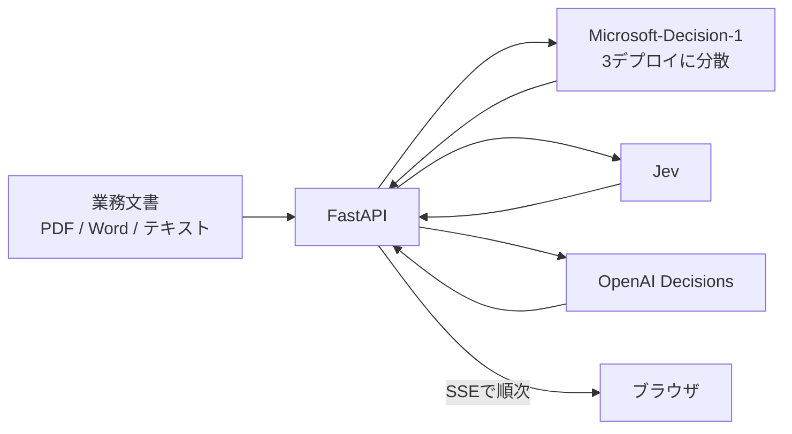
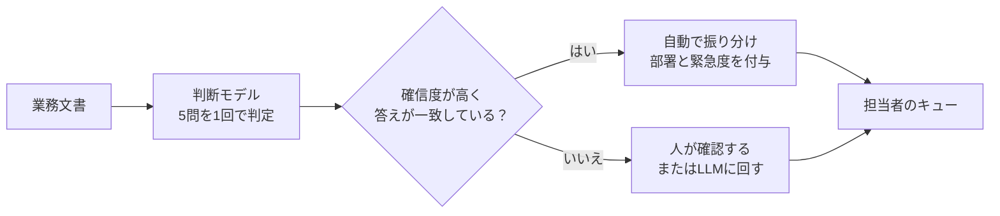
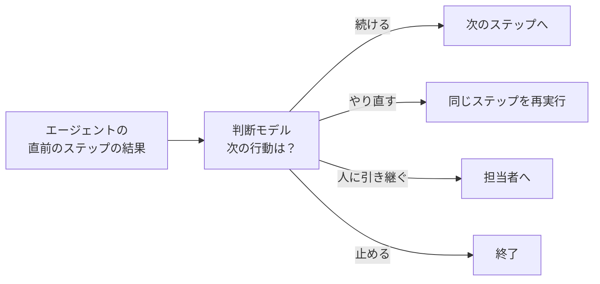
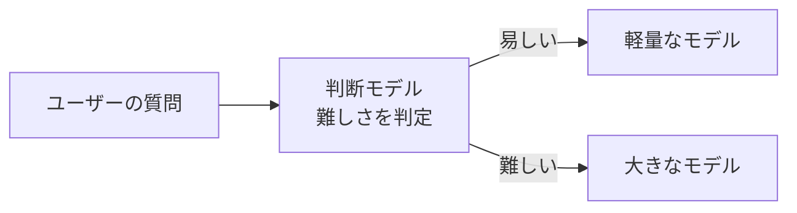

# はじめに

判断モデルといわれるモデルとして、まずJevが出て、OpenAIがDecisions APIを出して、今度はMicrosoftからも出ましたねー。流れが速いです。Microsoft-Decision-1は、文章は生成せず、選択肢ごとの確率だけを返す「判断専用」のモデルで、Foundryから使えます。

https://commandline.microsoft.com/microsoft-decision-1-model-foundry/

3つで何が違うのか気になったので、Foundryにデプロイして、日本語の業務文書で比べてみました。先に結論です。

- 精度は、モデルの差より**設問の書き方で大きく変わります**
- **一番速いのはJev**で、**一番安いのはMicrosoft**です
- Microsoftの公称85msは、**日本から使うと出ません**

試したのはドキュメント分類を一斉にやる。というシーンです！
https://youtu.be/Dso6P64SLdg

:::message alert
本記事の内容は **2026年10月10日時点** の情報に基づいています。Microsoft-Decision-1もOpenAI Decisions APIも出たばかりで、仕様や挙動が変わる可能性があります。数値はすべて、日本の自宅回線から自作のテストデータで測ったものです。
:::

### 参考情報

https://developers.openai.com/api/docs/guides/decisions
https://docs.typesafe.ai/introduction/quickstart

---

# Microsoft-Decision-1とは

たとえるなら、受付の振り分け担当です。問い合わせを読んで「これは経理」「これは急ぎ」と指さすだけで、理由の説明も返信文も書きません。Jevで話題になった「System Oneモデル」と同じ系統です。

https://typesafe.ai/blog/introducing-system-one-models-and-jev
https://docs.typesafe.ai/concepts/system-one

| 項目 | 内容 |
|------|------|
| 発表 | 2026年10月9日（MicrosoftのOffice of the CTOのブログ） |
| ベース | Qwen3.5-9Bを追加学習したもの。重みは配布されない |
| 入力 | テキストのみ。コンテキストは32,768トークン |
| 料金 | 入力$0.042/100万トークン、出力は無料 |
| 呼び出し | chat/completionsではなく専用のエンドポイント。認証はAPIキーかEntra ID |
| 状況 | Tech Communityは「public preview」、モデルカタログは「GA」と表記が食い違う |

https://commandline.microsoft.com/microsoft-decision-1-model-foundry/
https://ai.azure.com/catalog/models/Microsoft-Decision-1

## ベースはQwen3.5-9B

オープンウェイトのQwen3.5-9Bを、判断用にpost-trainしたものです。発表ブログには、**近いうちにMAIやOpenAIのモデルなどにリベースする**とも書かれています。

https://huggingface.co/Qwen/Qwen3.5-9B
https://techcommunity.microsoft.com/blog/azure-ai-foundry-blog/introducing-microsoft-decision-1-in-microsoft-foundry-for-decision-and-classific/4562742

---

# Foundryで動かす

## デプロイ

今回は、あえてAzure CLIで払い出してみます。FoundryのPortalから、モデルカタログで探してデプロイする手順は、JPさんの記事に書かれているので、ぜひそちらを見てみてください。

https://zenn.dev/microsoft/articles/ms-decision-1

コマンドは、Microsoft Learnのハウツーがベースです。`--sku-capacity`は、そのまま1分あたりのリクエスト数になります。

https://learn.microsoft.com/en-us/azure/foundry/foundry-models/how-to/use-foundry-models-microsoft-decision

```bash
az cognitiveservices account create \
  -n <リソース名> -g <リソースグループ> -l eastus2 \
  --kind AIServices --sku S0 --custom-domain <リソース名> --yes

az cognitiveservices account deployment create \
  -n <リソース名> -g <リソースグループ> \
  --deployment-name decision1 \
  --model-name "Microsoft-Decision-1" --model-format Microsoft --model-version "1" \
  --sku-name GlobalStandard --sku-capacity 100
```

## まずは呼んでみる！！

専用のSDKはまだなく、普通にHTTPで呼びます。3種類の質問をまとめて投げます。

```python
import os
import httpx

url = f"{os.environ['AZURE_ENDPOINT']}/providers/microsoft/v1/systemone"
body = {
    "model": "decision1",  # デプロイ名
    "state": "請求書の金額が契約と違います。至急確認してください。",
    "questions": {
        "team": {
            "type": "choice",
            "instructions": "この問い合わせを担当すべきチームはどれか？",
            "criteria": {
                "billing": "請求・支払い・返金",
                "engineering": "不具合・エラー・障害",
                "support": "使い方・アカウントの質問",
            },
        },
        "severity": {
            "type": "score",
            "instructions": "この問題の深刻度は？",
            "criteria": ["軽微", "中程度", "重大", "致命的"],
        },
        "urgent": {
            "type": "noul",
            "instructions": "送信者は緊急の対応を求めているか？",
        },
    },
}
r = httpx.post(url, headers={"api-key": os.environ["AZURE_API_KEY"]}, json=body)
print(r.json())
```

返ってくるのは、こんなJSONです（桁は丸めています）。

```json
{
  "model": "microsoft-decision-1",
  "answers": {
    "team": {
      "type": "choice",
      "choice": "billing",
      "confidence": 0.9999,
      "probabilities": {"billing": 0.9999, "engineering": 0.00004, "support": 0.00003}
    },
    "severity": {
      "type": "score",
      "score": 1.05,
      "confidence": 0.93,
      "probabilities": {"0": 0.0003, "1": 0.946, "2": 0.053, "3": 0.000003}
    },
    "urgent": {"type": "noul", "noul": 0.9998}
  },
  "usage": {"input_tokens": 115, "output_tokens": 3}
}
```

入力した文面は日本語のまま通ります。結果から分かる通り、LLMとは異なり文章生成ではないので、`output_tokens`が3になってますね！！

## 3つの質問タイプ

| タイプ | 聞けること | 返ってくるもの |
|--------|-----------|----------------|
| `noul` | はい/いいえ | 「はい」の確率 |
| `choice` | 選択肢から1つ | 選択肢ごとの確率、選ばれたラベル、`confidence` |
| `score` | 順序のある段階 | 段階ごとの確率、確率で加重平均した`score` |

上の例の`score`の1.05は、「中程度が中心で、少し重大寄り」という意味です。`confidence`は選んだラベルの確率とは別物なので、閾値はどちらで置くか決めておきましょう。

---

# JevとOpenAI Decisions APIの違い

3つとも判断だけ返す点は同じで、違うのはAPIの形、入力、料金です。

| | Microsoft-Decision-1 | Jev | OpenAI Decisions API |
|---|---|---|---|
| 公開 | 2026/10/9 | 2026/9/15 | 2026/10/6（public beta） |
| エンドポイント | `/providers/microsoft/v1/systemone` | `/v1/systemone` | `/v1/decisions` |
| リクエスト | `state` + `questions`（辞書） | 同左 | `input` + `questions`（配列） |
| 真偽の質問 | `noul` | `noul` | `predicate` |
| 選択肢の渡し方 | `criteria`（ラベル: 説明） | 同左 | `choices`（value, description） |
| 画像入力 | 不可 | 不可 | 可（base64） |
| 入力料金（出力は無料） | $0.042/100万トークン | $0.042/100万トークン | $0.10/100万トークン |
| 回答の拒否 | - | - | 質問ごとに`refusal`が返ることがある |

https://developers.openai.com/api/docs/guides/decisions
https://developers.openai.com/api/docs/changelog
https://docs.typesafe.ai/introduction/quickstart

**MicrosoftとJevは形がほぼ同じ**で、URLとキーとモデル名を替えれば切り替えられます。**OpenAIだけ形が違い**、画像も入れられます。同じ質問を投げると、こんな形です。

```python
body = {
    "model": "gpt-6-luna",
    "input": "請求書の金額が契約と違います。至急確認してください。",
    "questions": [
        {
            "type": "choice",
            "name": "team",
            "instructions": "この問い合わせを担当すべきチームはどれか？",
            "choices": [
                {"value": "billing", "description": "請求・支払い・返金"},
                {"value": "engineering", "description": "不具合・エラー・障害"},
                {"value": "support", "description": "使い方・アカウントの質問"},
            ],
        },
        {"type": "predicate", "name": "urgent", "instructions": "送信者は緊急の対応を求めているか？"},
    ],
}
httpx.post("https://api.openai.com/v1/decisions",
           headers={"Authorization": f"Bearer {os.environ['OPENAI_API_KEY']}"}, json=body)
```

https://developers.openai.com/api/reference/resources/decisions/methods/create

---

# 日本語の業務文書で比べてみる

## テストデータ

自作の業務文書240件に、同じ5問を聞きました。メール、チャット、議事録、申請フォームなどで、実在の名前は使わず、すべて合成です。約2割は、わざと難しくしてあります。実際の文書は、折りたたんで載せます。

:::details 業務文書のサンプル（かんたんな例）

3つとも、3社が5問すべて正解した文書です。

請求書（PDFから抜き出したテキスト）

```text
請 求 書
請求番号：INV-2026-0931
発行日：2026年10月5日
株式会社サンプル商事 御中

有限会社ほげ工房
下記のとおりご請求申し上げます。

品目                         数量   単価      金額
販促用ノベルティ（トート）   500    680      340,000
デザイン費                   1式    80,000    80,000
小計                                         420,000
消費税（10%）                                 42,000
ご請求金額                                   462,000円

お支払期限：2026年11月30日
```

正解は次のとおりです。

| 文書の種類 | 部署 | 機密 | 要対応 | 緊急度 |
|---|---|---|---|---|
| 請求・見積 | 経理 | 機密 | はい | 低 |

障害の事後共有（チャット）

```text
開発チームの皆さまへ共有です。
昨日18時のリリース後に発生していた商品一覧ページの表示崩れ（Safariのみ）は、19:30にロールバックして解消しています。
原因はCSSの指定ミスで、修正版は次回リリースに含めます。
現時点で追加の対応はありません。
```

正解は次のとおりです。

| 文書の種類 | 部署 | 機密 | 要対応 | 緊急度 |
|---|---|---|---|---|
| 障害 | 開発 | 社内限定 | いいえ | 低 |

値引きの承認申請（フォーム）

```text
【特別値引き承認申請】
案件：株式会社架空フーズ様 POS入替（12店舗・24台）
標準価格：3,312,000円
申請価格：2,815,200円（値引率 15%）
理由：競合（他社製品）の見積が当社比 −12%。デモの評価は当社が上回っており、価格差が縮まれば受注の見込み大。
提案日：明日10/11 午前
営業部長の承認を本日中にお願いします。
営業部 佐藤

補足：
・架空フーズ様は12店舗のうち、来年さらに3店舗の出店計画があり、受注できれば追加の受注も見込めます。
・値引き後の粗利率は 31%（標準 42%）で、営業部の値引き権限（部長承認で20%まで）の範囲内です。
・設置作業費は店舗をまとめて施工することで、別途 約8万円の原価低減ができる見込みです。
```

正解は次のとおりです。

| 文書の種類 | 部署 | 機密 | 要対応 | 緊急度 |
|---|---|---|---|---|
| 申請・稟議 | 営業 | 機密 | はい | 高 |

:::

:::details 判断が難しい文書の例（わざと混ぜたもの）

わざと難しくした文書のうち、3つを載せます。表は、正解と各モデルの答えです。外した答えには × を付けています。

議事録の中に進行中の障害報告が埋まっている

```text
開発部 週次定例 議事録（10/10 10:00〜）
1. 各チーム進捗
 ・アプリチーム：iOS v4.2.1 の修正版を審査提出済み
 ・基盤チーム：ログ基盤移行 70%
2. 採用状況：バックエンド1名 内定承認待ち
3. その他・連絡事項
 ・10:40 会議中にCSから連絡あり。ECサイトで決済エラーが継続発生中（10:32〜）で、現在も復旧していない。対応担当がまだ決まっていないため、基盤チームから至急アサインすること。
次回：10/17

（記録：吉川／欠席：アプリチーム 1名）
```

文書の形式は議事録ですが、末尾に「決済エラーが継続中で、担当が決まっていない」とあります。種類は議事録、でも対応は必要で緊急、というややこしい文書です。

| 質問 | 正解 | Microsoft | Jev | OpenAI |
|---|---|---|---|---|
| 文書の種類 | 議事録 | 議事録 | 議事録 | 議事録 |
| 部署 | 開発 | 開発 | 開発 | 開発 |
| 機密 | 社内限定 | 社内限定 | 社内限定 | 社内限定 |
| 要対応 | はい | いいえ × | はい | はい |
| 緊急度 | 緊急 | 緊急 | 緊急 | 緊急 |

件名は至急なのに急ぎではない

```text
件名：【至急】ご請求書送付の件

株式会社サンプル商事 経理部 御中

お世話になっております。株式会社ダミーソリューションズの小林です。
11月分保守料のご請求書を先行してお送りします。
請求金額：214,500円（税込）
お支払期日：2026年12月31日

社内システムの都合で「至急」の件名で送信されております。お支払いは通常どおり期日までで問題ございません。
```

本文に「社内システムの都合で至急と付いているだけ。お支払いは通常どおり期日まで」と書いてあります。支払い自体は必要なので要対応は「はい」、でも期日は年末で急ぎではないので緊急度は「低」が正解です。「急ぎではない」を「対応不要」と読むと外します。

| 質問 | 正解 | Microsoft | Jev | OpenAI |
|---|---|---|---|---|
| 文書の種類 | 請求・見積 | 請求・見積 | 請求・見積 | 請求・見積 |
| 部署 | 経理 | 経理 | 経理 | 経理 |
| 機密 | 機密 | 機密 | 機密 | 機密 |
| 要対応 | はい | いいえ × | はい | いいえ × |
| 緊急度 | 低 | 中 × | 低 | 低 |

問い合わせへの返信で対応は不要と書いてある

```text
件名：Re: 管理画面にログインできない件

サポートご担当者様
昨日お問い合わせしたログインできない件ですが、ブラウザのキャッシュを削除したら無事ログインできました。
自己解決しましたので、この件の対応は不要です。お騒がせしました。

合同会社テストラボ 山口
```

障害の話題が出てきますが、すでに自己解決していて、こちらがやることはありません。

| 質問 | 正解 | Microsoft | Jev | OpenAI |
|---|---|---|---|---|
| 文書の種類 | 問い合わせ | 障害 × | 問い合わせ | 問い合わせ |
| 部署 | CS | 情シス × | CS | CS |
| 機密 | 社内限定 | 社内限定 | 社内限定 | 社内限定 |
| 要対応 | いいえ | いいえ | いいえ | いいえ |
| 緊急度 | 低 | 低 | 低 | 低 |

:::

| 質問 | 形式 |
|------|------|
| 文書の種類（契約、請求、議事録、障害、問い合わせ、申請、仕様、報告、その他） | 9択 |
| 一次対応する部署 | 7択 |
| 機密レベル | 4段階 |
| 受信者の対応が必要か | はい/いいえ |
| 緊急度 | 4段階 |

:::details 実際に投げた設問（5問）

`state`に文書を入れて、`questions`にこの5問を入れて1回で投げます。

```json
{
  "doc_type": {
    "type": "choice",
    "instructions": "この文書の種類として最も適切なものはどれか？中身に別の話題が含まれていても、文書そのものの形式・主題で判断する。",
    "criteria": {
      "contract": "契約書・覚書・利用規約・NDAの本文や抜粋、または契約文書そのものが主題の送付・審査依頼",
      "invoice": "請求書・見積書・発注書・支払通知・入金確認など、金額と取引を示す文書",
      "minutes": "会議の議事録・打ち合わせメモ（中に障害報告などが含まれていても形式が議事録ならこれ）",
      "incident": "システム障害・事故・不具合の報告や連絡、事後のポストモーテム",
      "inquiry": "顧客・取引先・応募者など社外からの問い合わせ・クレーム・要望（社員から社内部署への質問は含まない）",
      "request": "社内の申請・稟議・経費精算・休暇・アカウント申請など、承認や手配を求める社内文書",
      "spec": "仕様書・設計書・手順書・マニュアル",
      "report": "日報・週報・月次報告など定期的な活動報告（単発の分析資料は含まない）",
      "other": "上記以外（社内告知、イベント案内、ニュースレター、営業メール、単発の分析資料など）"
    }
  },
  "department": {
    "type": "choice",
    "instructions": "この文書を一次対応すべき部署はどこか？",
    "criteria": {
      "finance": "経理・財務：支払、請求、経費、予算。顧客・取引先からの請求額誤り・再発行・入金確認の問い合わせもここ",
      "legal": "法務：契約審査、紛争、法的措置の示唆、契約解除通知、コンプライアンス",
      "it": "情報システム：社内システム・社内アカウント・セキュリティの問題",
      "cs": "カスタマーサポート：顧客からのサービスへの苦情や使い方の質問",
      "hr": "人事・総務：雇用契約、勤怠、採用、福利厚生、施設や社内イベント",
      "sales": "営業：見込み客の見積依頼・商談・受注処理",
      "dev": "開発：顧客向け製品の不具合やプロダクト障害、製品の設計・実装"
    }
  },
  "confidentiality": {
    "type": "score",
    "instructions": "この文書の機密レベルはどれか？",
    "criteria": [
      "公開可：公開済みの規約、プレスリリース、公開ドキュメント、一般向け案内、迷惑営業メール",
      "社内限定：社内の定常資料、社内告知、署名程度の個人情報しか含まない問い合わせ、定価のみの書類",
      "機密：特定相手との取引条件や金額、単一顧客の個人情報や注文情報、未発表情報、契約ドラフト、認証情報を含まないセキュリティ事故",
      "極秘：パスワードやAPIキーなどの認証情報、M&A、給与一覧、多数人の個人情報"
    ]
  },
  "action_required": {
    "type": "noul",
    "instructions": "受信者が何らかの対応（返信・承認・作業・支払いなど）をする必要があるか？",
    "criteria": {
      "true": "受信者に返信・承認・作業・支払いなどの対応が求められている。議事録なら受信者にタスクが明示的に割り当てられている。報告書なら受信者に判断や承認を求めている",
      "false": "情報共有・通知・報告のみで受信者の対応は不要。対応不要と明記されている、または既に解決済み"
    }
  },
  "urgency": {
    "type": "score",
    "instructions": "対応の緊急度はどれか？「至急」などの表記より、実際の期限と影響を優先して判断する。対応不要なら必ず「低」。",
    "criteria": [
      "低：対応不要、期限なし・いつでもよい、社内の申請で期限が1週間より先",
      "中：数日〜1週間以内の期限。社外（顧客・取引先）からの問い合わせで期限の明示がないもの",
      "高：当日〜翌日の期限",
      "緊急：業務や顧客への深刻な影響が進行中で、直ちに対応が必要"
    ]
  }
}
```
:::

公開データとして、AmazonのMASSIVE（日本語と英語の対訳120件、意図分類60択）も使いました。

https://huggingface.co/datasets/AmazonScience/massive
https://arxiv.org/abs/2204.08582

## 精度

ルールを選択肢の説明に書いた設問での結果です。

| | 文書の種類 | 部署 | 機密 | 要対応 | 緊急度 | 5問すべて正解 |
|---|---|---|---|---|---|---|
| Jev | 97.1% | 95.4% | 92.1% | 95.8% | 92.1% | 75.0% |
| OpenAI | 95.8% | 94.2% | 89.2% | 93.3% | 92.9% | 70.8% |
| Microsoft | 95.8% | 92.9% | 88.3% | 93.3% | 85.8% | 63.3% |

**差がはっきり出たのは緊急度**で、JevとOpenAIがMicrosoftより上でした（McNemar検定、p<0.05、補正なし）。ほかの4問は、ほぼ横並びです。5問すべて正解だと、小さな差が掛け合わさって開いて見えます。素の設問では、Microsoftだけ機密度を低めに出す傾向がありました（外した52件のうち47件）。

## 設問の書き方で、ここまで変わる

モデルの差より大きかったのが設問の書き方です。ルール表を選択肢の説明に書き込む前後で比べました。

| 5問すべて正解 | 素の設問 | ルールを書き込んだ設問 |
|---|---|---|
| Jev | 57.5% | 75.0% |
| OpenAI | 51.7% | 70.8% |
| Microsoft | 47.9% | 63.3% |

**どのモデルも大きく上がりました**（15〜19ポイント）。たとえば緊急度の選択肢に「社外からの問い合わせで期限の明示がないものは『中』」と書いておきました。判断モデルは書かれていないルールを補ってくれないので、**人間に説明するつもりでルールを書くと精度が上がります。**

## 確信度は信じていいのか

確信度のずれは、ECE（小さいほど良い）で見ました。

| | 素の設問 | ルールを書き込んだ設問 |
|---|---|---|
| Jev | 0.014 | 0.046 |
| OpenAI | 0.038 | 0.065 |
| Microsoft | 0.082 | 0.047 |

素の設問ではMicrosoftが一番ずれていて、ルールを書き込むと3つとも0.05前後になりました。公称の校正スコア92.2とは指標が違うので直接は比べられませんが、**閾値は実データで確かめてから決める**のが安全です。

## 速さ

日本の自宅と、米国中部（Central US）のAzureコンテナから、MASSIVEの60件を1件ずつ投げて、中央値を取りました。入力が大きいほうは約1,300トークン、小さいほうは英語の短文に3択を1問です。

| 呼び出し元 | 入力 | Jev | OpenAI | Microsoft（DataZone） | Microsoft（Global） |
|---|---|---|---|---|---|
| 日本 | 大 | 172ms | 199ms | 361ms | 317ms（p95 1,165ms） |
| 日本 | 小 | 173ms | 196ms | 287ms | 245ms（p95 768ms） |
| Central US | 大 | 125ms | 131ms | 223ms | 250ms（p95 838ms） |
| Central US | 小 | 122ms | 130ms | 140ms | 146ms（p95 303ms） |

DataZoneはEast US 2のリソース、Globalは呼び出し元に近いほうのリソースです。

- **公称のp50の85msは再現しませんでした**。最良の条件でも140msで、往復を引くとサーバー側は約110msです
- **入力が長いほど遅くなる**のはMicrosoftだけです（140msから223ms）
- **GlobalStandardは処理場所がバラバラ**で、p95が大きくなります。DataZoneStandardは固定で安定しますが、Japan Eastには用意されていません

## 全件の振り分けが終わるまで

業務では、1件の速さより「この量が何秒で片付くか」が気になります。業務文書から60件と240件を取り出して、3つを同時に流しました（Microsoftは3つのデプロイに分散）。

| 件数 | Jev | OpenAI | Microsoft |
|---|---|---|---|
| 60件（3回） | 2.0〜3.4秒 | 2.2〜3.8秒 | 2.6〜3.4秒 |
| 240件（2回） | 6.2〜6.3秒 | 6.6〜6.9秒 | 7.8〜8.1秒 |

60件は順位が入れ替わるほど接近していて、240件では**Microsoftが約3割遅く**なりました。Microsoftはデプロイごとに1分あたりの上限があり（今回は合計274件/分）、超えると次の1分まで待たされます。多いときは、デプロイを分けるか、クォータの引き上げを申請しましょう。

https://learn.microsoft.com/azure/foundry/foundry-models/quotas-limits
https://aka.ms/oai/stuquotarequest

## コスト

同じ5問で240件を流したときの、1文書あたりの入力トークンと、1万件あたりの料金です。

| | 平均入力トークン | 1万件あたり |
|---|---|---|
| Microsoft | 995 | 約$0.42 |
| Jev | 1,998 | 約$0.84 |
| OpenAI | 1,787 | 約$1.79 |

単価が同じでも、**トークン数がMicrosoftとJevで約2倍違い**ました（トークナイザーの違いだと思います）。**一番安いのはMicrosoft**です。

https://docs.typesafe.ai/models

## 選択肢の並び順

選択肢を逆順にして投げ直して、答えが変わった割合です。

| 素の設問で測定 | 業務文書（文書種別） | 業務文書（部署） | MASSIVE（意図、日本語） |
|---|---|---|---|
| Microsoft | 0.0% | 0.0% | 0.0% |
| Jev | 2.5% | 0.8% | 6.7% |
| OpenAI | 6.2% | 6.7% | 10.0% |

**Microsoftは並び順に左右されません**。ただしキー名には敏感で、`opt_00`のような意味のない名前にすると、12件のうち2件で答えが変わりました。ラベルには、意味のある名前を付けましょう。

## 日本語と英語

| | 日本語 | 英語 |
|---|---|---|
| Microsoft | 86.7% | 90.0% |
| Jev | 85.8% | 87.5% |
| OpenAI | 80.0% | 83.3% |

MASSIVEの日英対訳120件での、意図分類（60択）の正解率です。どれも英語が2〜3ポイント高いだけで、**日本語でも実用になる水準**です。

---

# 実例：業務ドキュメントを一斉に振り分ける

「溜まった業務文書を一気に仕分ける」デモを作りました。ドロップした文書を3つのモデルに同時に投げて、種類ごとの箱にカードが飛んでいきます。
※わかりやすくUIを用意してますが、業務で使うときはシステムに組み込んで動かすと思うのでUIはいりません！
https://youtu.be/Dso6P64SLdg



:::details 実際の文書と、3つのモデルの答え

```text
法務部 御中

総務部の遠藤です。旧倉庫（9月退去）の貸主から原状回復費用の請求書が届きました。
請求額：3,850,000円（内訳：床全面張替え、壁クロス全面交換、空調洗浄）
入居時の契約では「通常損耗は貸主負担」となっており、全面張替えを当社負担とするのは納得できません。
支払期限が来週火曜（10/20）となっているため、それまでに貸主との交渉方針を法務部で検討いただけないでしょうか。
請求書と賃貸借契約書の写しを添付します。

経緯：
・旧倉庫は2019年から6年間賃借していました。退去時の立会いでは、貸主側の担当者から特段の指摘はありませんでした。
・請求書の内訳には、フォークリフトの走行による床の摩耗（約180万円）も含まれていますが、倉庫として使うことは契約時に先方も了承済みです。
・管理会社からは「期日までに支払いがなければ敷金（240万円）と相殺する」との連絡も来ています。
```

括弧の中は、選んだ答えの確率です。

| 質問 | 正解 | Microsoft | Jev | OpenAI |
|---|---|---|---|---|
| 文書の種類 | 申請・稟議 | 申請・稟議（0.99） | 申請・稟議（0.98） | その他（0.36） × |
| 部署 | 法務 | 法務（1.00） | 法務（1.00） | 法務（0.99） |
| 機密 | 機密 | 機密（0.53） | 機密（0.93） | 機密（0.99） |
| 要対応 | はい | はい（1.00） | はい（0.96） | はい（1.00） |
| 緊急度 | 中（低でも可） | 中（1.00） | 中（0.88） | 中（0.62） |
:::

1,200問のうち、**3社とも正解した**のは1,027問（86%）で、3社とも外したのは21問、残りの152問で答えが割れました。**確信度が低いものや割れたものだけを人に回す**と、全部を人が見るよりずっと楽になります（運用のイメージです）。



他にも、こんな使い方が合いそうです。

- エージェントの次の行動の判断（続ける、止める、やり直す、引き継ぐ）
- LLMの回答の合否判定（承認、修正、却下）
- モデルのルーティング（簡単な質問は安いモデルへ、難しい質問は大きなモデルへ）
- 問い合わせの一次振り分け（部署と緊急度を一緒に出す）





---

Microsoft-Decision-1は、Qwen3.5-9Bがベースで、今後はMAIやOpenAIのモデルに載せ替える予定だそうなので、今後も楽しみですね！

# 参考

- [Microsoft-Decision-1公式ドキュメント](https://learn.microsoft.com/ja-jp/azure/ai-services/openai/concepts/models#microsoft-decision-1)
- [Jev公式ドキュメント](https://docs.jev.ai/)
- [OpenAI Decisions公式ドキュメント](https://platform.openai.com/docs/guides/decisions)